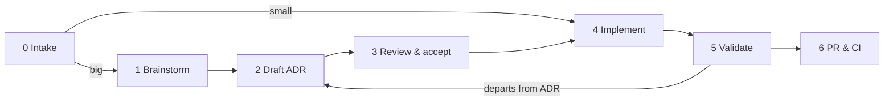

# EGM (Elephant-and-Goldfish Model)

How the EGM skills fit BeziSync. EGM runs design and review loops with an *Elephant* (the agent
holding the context) and *Goldfish* (fresh-context reviewers that see only what they are handed).
Its defaults assume a generic repository: `docs/designs/`, a `SITEMAP.md`, and working files
dropped in the working directory. This file maps those defaults onto how BeziSync already works,
so a run lands in the right place and ends in a clean PR.

When this file and an EGM skill's default disagree, **this file wins**. When it disagrees with
[AGENTS.md](../AGENTS.md) or another rule file, follow the stricter of the two and say so.

## Setup

The plugin is **optional**. The directory contracts, `make contracts-check` and the
[pre-PR gate](pre-pr.md) apply whether or not it is installed; without it you only lose the
`egm-*` skills.

- **Claude Code:** `claude plugin marketplace add google/elephant-goldfish-model && claude plugin install egm@egm`, then run `/egm:egm-brainstorm`, `/egm:egm-draft`, `/egm:egm-review` and so on.
- **Codex CLI:** `codex plugin marketplace add google/elephant-goldfish-model && codex plugin add egm@egm`, then pick the skill in the skill picker.
- **Other tools:** see EGM's [harness list](https://github.com/google/elephant-goldfish-model/blob/main/docs/harnesses.md).

An agent asked to run an `egm-*` skill that isn't installed points the user here instead of improvising it.

---

## From idea to PR

The end-to-end path an agent follows when the user brings an idea, from the first conversation
to a validated, green PR. Each stage names its exit condition and whether the agent **stops for
the user**. Stages link to the rule that owns the detail; this section only fixes the order.



| # | Stage | What happens | Done when | Stop for the user? |
|---|---|---|---|---|
| 0 | **Intake** | Discuss the idea in chat: no code, branches or worktrees yet. Classify it with [adr.md](adr.md#when-an-adr-is-required). **Small** changes (fix, patch, minor feature) skip to stage 4; **big** ones go through stages 1–3. | Scope, size and non-goals agreed | **Yes:** wait for an explicit go-ahead |
| 1 | **Brainstorm** | `egm-brainstorm` stress-tests the concept and writes `.egm/concepts_brief.md`. | Concept, risks and open questions written down | **Yes:** confirm the concept |
| 2 | **Draft** | `egm-draft` writes `docs/adr/NNNN-kebab-title.md` (`Proposed`, index row; see [Designs are ADRs](#designs-are-adrs)), ending in an **implementation plan** (target files, one commit per logical step) and a **verification plan**. The verification plan holds the tests, the e2e specs, and an **edge-case register**: rows of ID, case and expected result, each mapped to the commit and test that cover it. | Every section approved, the gap sweep done | **Yes:** section by section |
| 3 | **Review & accept** | `egm-review` with the right [Goldfish context](#goldfish-context), then `egm-resolve` folds the findings into the ADR. Set the status to `Accepted` when the user approves. | Findings resolved, ADR `Accepted` | **Yes:** approval of the design |
| 4 | **Implement** | Branch from an up-to-date `preview` (`<type>/<slug>`), in a separate worktree when another session is using the main checkout. Build to the plan under [backend.md](backend.md) / [frontend.md](frontend.md). Code, tests (written first for each edge-case row) and [directory contracts](#directory-contracts) change together, **one logical commit at a time**. Each commit passes the quick gates (`make verify-quick GO_PKGS=…`, `make e2e-quick SPECS=…` on what it touches) and is **pushed** at once. The ADR goes in the same branch and PR by default ([adr.md](adr.md#the-flow)). | Every implementation-plan item committed and pushed | Only if the code must depart from the ADR (back to stage 2) |
| 5 | **Validate** | Run [pre-pr.md](pre-pr.md) end to end: the triggered obligations, the full gates, real-app checks (screens at 390/768/1280 px in light and dark, API as a permitted and a denied caller, real Postgres/Kafka/Debezium through e2e), the ADR's edge-case register **row by row**, a self-review, and `egm-drift-report` on the ADR and the touched contracts. Fix everything found and re-run. | All green, drift report clean, anything not run written down with the reason | No: keep fixing until done |
| 6 | **PR & CI** | `gh pr create --base preview` with the [template](../.github/pull_request_template.md) filled from stage 5's evidence (commands, specs run, results, screenshots, follow-ups). Watch CI and fix anything red. | CI green | **Yes:** hand off with the PR link and what was and wasn't verified |

Rules that hold across the stages:

- **Never skip a stop.** A "yes" at one stage is not approval for the next.
- **One request, one PR, many commits.** Everything the user batched into one thread ships as one
  PR, ADR included, with separate logical commits (pull requests are squash-merged).
- **Follow-ups go in a new PR** once the PR is open (the maintainer merges fast). Before pushing
  to an existing PR branch, check that the PR is still open.
- **The ADR is the spec.** When reality disagrees with it during stages 4–5, change the ADR
  first (while unmerged), then the code.
- **Leave nothing behind.** Use labeled, disposable test infrastructure (`app.bezisync.io/e2e=true`)
  and tear down what you created. Never touch another session's checkout, cluster or containers.
- **Working files stay in `.egm/`.** Commit only the ADR, code, tests, contracts and docs.
- **Small changes still validate.** Skipping stages 1–3 never skips stage 5.

---

## Where files go

| EGM output | Location | Committed? |
|---|---|---|
| `concepts_brief.md` (egm-brainstorm) | `.egm/` | No |
| `design_draft.md`, `discussion_summary.md` (egm-draft) | `.egm/` | No |
| `goldfish_review_report.md`, resolve notes (egm-review, egm-resolve) | `.egm/` | No |
| `{YYYY-MM-DD}_DRIFT_REPORT.md` (egm-drift-report) | `.egm/` | No |
| The finished design | `docs/adr/NNNN-kebab-title.md` | Yes |
| Directory contracts (egm-bootstrap) | `README.md` in each code directory, rolled up in [ARCHITECTURE.md](../ARCHITECTURE.md) | Yes |

`AGENTS.md` declares `EGM artifact directory: .egm/`, and `.egm/` is git-ignored. Paste the
review findings that matter into the ADR or the PR instead of committing reports.

## Designs are ADRs

A design produced with `egm-draft` is an [ADR](adr.md). Don't create `docs/designs/` or
`SITEMAP.md`.

1. **Target directory:** when `egm-draft` asks where to save, pick `docs/adr/`.
2. **Filename:** the next free number (`ls docs/adr | grep -E '^[0-9]{4}-' | sort | tail -1`, plus one).
3. **Header:** `# NNNN — Title`, then the bullets from the [template](../docs/adr/README.md#format)
   (`Status: Proposed`, `Date`, `Scope`).
4. **Sections:** keep the MADR spine (Context, Decision, Consequences, Alternatives
   considered) and fold EGM's sections into it:

   | EGM template section | Goes in |
   |---|---|
   | Overview, The Problem, Goals, Non-Goals, CUJs | Context |
   | Technical Plan, Non-Functional Requirements | Decision |
   | Detailed Implementation Plan, Target Files, Verification Plan | Decision, under *Implementation plan* and *Verification plan* (with the edge-case register) |
   | Alternatives Considered | Alternatives considered |
   | Open Questions, Future Improvements | Consequences, or *Open questions* while `Proposed` |

5. **Index:** add the row to `docs/adr/README.md`. There is no sitemap.
6. **Never rewrite an `Accepted` decision.** Supersede it. A drift finding against an
   accepted ADR is fixed in the code or in a new ADR.

## Goldfish context

Goldfish reviewers see only what you pass them:

- **`egm-review` / `egm-review-loop`:** pass the `README.md` contract of every directory the
  design touches, plus [ARCHITECTURE.md](../ARCHITECTURE.md) for anything spanning API,
  controller and UI. Add any ADR it amends.
- **Security-relevant designs** (secrets, auth/RBAC, SSRF, agents, MCP, outbound calls): also
  pass the [threat model](../docs/security/threat-model.md) and the security parts of
  [backend.md](backend.md).
- **Database changes:** pass the migration rules in [backend.md](backend.md) and
  `backend/internal/migrate/README.md`.
- **Compiler or `config_hash` changes:** pass `backend/internal/compiler/README.md` and
  state the invariant that existing specs compile to the same `config_hash`.
- **Paths, not URLs:** pass absolute paths. Reviewers cannot open URLs, so save any page they
  should read into `.egm/` and pass that path.

---

## Directory contracts

Every code directory carries a `README.md` contract. The first set was generated by
`egm-bootstrap`; from now on they are maintained by hand, in the same change as the code.

**Component** (a directory with source files):

```markdown
# <name>

## Overview
What the directory is for and how it fits its parent.

## Interface
- `[file.go:ExportedSymbol]`: one line on what it is
- Subdirectories: [child](./child/README.md), one line each

## Invariants
- Rules callers and editors must keep, each citing `[file.go:symbol]`

## Side Effects
- DB tables written, network calls, goroutines/timers, files, env vars, audit entries — or `None`

## Verification
- Run: `<a command that exercises this directory>`
```

**Blueprint** (subdirectories only): `# <name>`, `## Overview`, and `## Subdirectories &
Boundaries`, with one linked line per child.

Rules:

- **Read the contract first** when you start work in a directory, and **update it in the same
  change** whenever you change an export, an invariant (permission, validation, limit, ordering,
  idempotency, secret handling), a side effect or the verification command. A new code
  directory gets a new contract, linked from its parent's.
- **Cite real code:** `[path/relative/to/this/README:Symbol]`, where the symbol appears in that
  file as a whole identifier. Never infer routes, permissions or tables from file names.
- **Describe the code as it is.** When the code breaks a project rule, state the behaviour
  plainly, record it in [ARCHITECTURE.md › Known issues](../ARCHITECTURE.md#known-issues), and
  open a follow-up.
- **Verification must run.** Backend: `make verify-quick GO_PKGS="./internal/<pkg>/"` (only where
  the package has tests). Frontend: `cd frontend && bun run test src/<dir>`. Tools:
  `cd tools && go test ./<pkg>/`. Without tests, write `No co-located tests; covered by …` and
  name the nearest scope that has tests.
- **Validate:** `make contracts-check` (in `make verify`, `make verify-quick` and CI) fails on a
  missing contract or section, a broken link, an unknown cited symbol, or a verification command
  with no tests to run.
- **Skip list:** [`.egmignore`](../.egmignore) lists the trees that carry no contracts (e2e,
  deploy, test helpers, docs). The READMEs ship in no image: `**/README.md` is in the
  `backend/` and `frontend/` `.dockerignore`, so editing a contract never needs a changelog
  fragment.

## Skill quick reference

| Skill | Use it for | Notes for this repo |
|---|---|---|
| `egm-brainstorm` | Testing an idea before designing | The brief goes to `.egm/`. Ideas are discussed first, with no code until asked. |
| `egm-draft` | Writing the design | Save it as an ADR, with an edge-case register in the verification plan. |
| `egm-review` / `egm-review-loop` | Fresh-context review of an ADR | Pass the contracts, plus the threat model for security work. Reports go to `.egm/`. |
| `egm-resolve` | Working through review findings | Fold the fixes into the ADR. |
| `egm-bootstrap` | Contracts for a new tree | Point it at the subtree, not the repo root (the root is `ARCHITECTURE.md`). It honours `.egmignore`. |
| `egm-drift-report` | A periodic check of contracts and ADRs against the code | The report goes to `.egm/`. Fix contract drift in a docs PR, and open issues for code bugs. |
