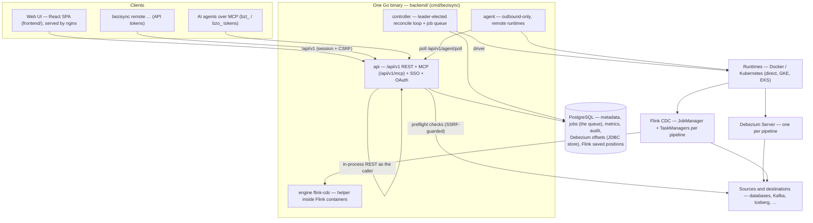

# Architecture

How BeziSync is put together, for contributors and coding agents. For what it does and how to run
it, see the [README](README.md) and the [guide](docs/README.md). The engineering rules are in
[AGENTS.md](AGENTS.md) and [`.rules/`](.rules/).

This file is the root of the **directory contracts**. Every code directory has a `README.md` with
an Overview, Interface, Invariants, Side Effects and Verification, kept true by `make contracts-check`
(rules: [.rules/egm.md](.rules/egm.md#directory-contracts)). Start here, follow the links down to the
directory you are changing, and read its contract before you edit it.

## System overview



- **One binary, several roles:** `bezisync api|controller|agent|migrate`, the `remote` CLI and the
  Flink CDC helper ([backend/internal/cli](backend/internal/cli/README.md)).
- **Thin edges, logic in services:** HTTP handlers ([api](backend/internal/api/README.md)) and MCP
  tools ([mcpserver](backend/internal/mcpserver/README.md)) authenticate, validate and call
  [services](backend/internal/services/README.md). The services call [connectors](backend/internal/connectors/README.md),
  the [compiler](backend/internal/compiler/README.md) and the runtime drivers.
- **PostgreSQL is the only dependency** and also the job queue. The [controller](backend/internal/controller/README.md)
  leads through an advisory lock and claims rows with `FOR UPDATE SKIP LOCKED`.
- **Health is derived, never assumed:** [domain](backend/internal/domain/README.md)'s `Derive` turns
  fresh evidence into a verdict. Missing or stale evidence is Unknown.

Design decisions are recorded as ADRs in [docs/adr/](docs/adr/README.md).

## Repository layout

| Path | What it is | Contract |
|---|---|---|
| `backend/` | The Go module behind the `bezisync` image | [backend](backend/README.md) → [internal](backend/internal/README.md) |
| `frontend/` | The React SPA and the nginx config of the `bezisync-web` image | [frontend](frontend/README.md) → [src](frontend/src/README.md) |
| `tools/` | Dependency-free Go module: release tool, licence files, demo smoke test, contract checker | [tools](tools/README.md) |
| `scripts/` | Bash entry points: dev DB, migrations, e2e cluster, demo smoke, CLI build, release | [scripts](scripts/README.md) |
| `deploy/` | Helm charts (control plane, agent), the compose demo, e2e fixtures, the AppArmor profile and its loader | — (charts: `make chart-test`) |
| `e2e/` | Playwright suite run against a disposable k3s-in-Docker cluster | — ([testing.md](.rules/testing.md)) |
| `docs/` | The user guide, the generated check reference, the threat model and the ADRs | [guide](docs/README.md), [ADRs](docs/adr/README.md) |
| `changelogs/` | Release-note fragments; never edit `CHANGELOG.md` | [fragments](changelogs/unreleased/README.md) |

## Cross-cutting invariants

These hold across directory boundaries. Breaking one is a design change and needs an ADR.

- **Secrets are encrypted at rest and write-only:** AES-256-GCM envelopes with key rotation
  ([security](backend/internal/security/README.md)), resolved only when compiled or checked
  ([services](backend/internal/services/README.md)). Compiled properties hold `${ENV}` references,
  never values ([compiler](backend/internal/compiler/README.md)). Reports are scrubbed.
- **Authorisation is project-scoped and concealed.** Unknown and forbidden projects both return
  404, and permissions are checked per route ([auth](backend/internal/auth/README.md)). MCP tools
  call the REST router in process as the caller, so the same checks apply
  ([mcpserver](backend/internal/mcpserver/README.md)).
- **Outbound connections to user-supplied addresses go through the SSRF guard**
  ([ssrf](backend/internal/ssrf/README.md); `.rules/backend.md`). See Known issues 1 for the places that don't.
- **A deployed spec keeps its `config_hash`.** The controller replaces workloads whose hash
  drifted, so the compiler and its JSON/YAML encoders stay byte-stable
  ([compiler](backend/internal/compiler/README.md), [pyjson](backend/internal/pyjson/README.md),
  [pyyaml](backend/internal/pyyaml/README.md)).
- **One settings registry.** Every option a pipeline may tune, for both engines, is an `engine.Setting` ([engine](backend/internal/engine/README.md)); the compiler, preflight, wizard, policies and MCP read it, and `compiler.ClassifyAdvanced` is the only judge of a raw key ([compiler](backend/internal/compiler/README.md)). A check BeziSync can't verify is `unknown`, never a pass ([checks](backend/internal/checks/README.md)).
- **The API is spec-first.** `backend/internal/api/openapi.json` is the contract the frontend
  client is generated from. `TestRoutesMatchOpenAPI` and `make openapi-check` keep the two in step.
- **Migrations are goose SQL, forward-only,** with `internal/migrate/testdata/schema.txt` updated
  in the same change ([migrate](backend/internal/migrate/README.md)).
- **State-aware safety:** destructive actions show their effect, are audited, and some need
  approvals or policies ([domain](backend/internal/domain/README.md), [services](backend/internal/services/README.md)).
- **The frontend gates the UI only:** the API decides. The UI never shows green without fresh
  evidence ([frontend/src/lib](frontend/src/lib/README.md)).

## Shared resources

- **PostgreSQL (BeziSync's database):** users, projects, connections (sealed), pipelines and
  versions, jobs, metrics, audit events, alerts, OAuth/SSO state, agents.
- **The state database** (often the same server): Debezium offsets and schema history (JDBC store),
  and Flink CDC saved positions (`debezium_state` schema).
- **Runtimes:** Docker Engine and Kubernetes APIs (workloads labelled by pipeline short id and
  owner), GKE/EKS token minting.
- **Sources and destinations:** preflight probes, heartbeat/signal/canary objects, replication
  slots, topics and tables that BeziSync creates and cleans up.
- **Outbound services:** SSO IdPs, secret stores (Vault, AWS, GCP, Kubernetes), alert channels
  (Slack, webhook, PagerDuty, SMTP), telemetry.

## Known issues

Code behaviour that contradicts a project rule. These were found by the 2026-11-06 contract
review, confirmed by reading the code (none were reproduced at runtime), and are recorded here
until fixed. Contracts that describe them link here. When you fix one, update the contract and
remove the entry.

| # | Issue | Where |
|---|---|---|
| 1 | Some outbound calls to user-supplied addresses check the host with the SSRF guard, then send through a plain `http.Client`. That client resolves DNS again, and for alerts also follows redirects. Database and broker drivers (pgx, MySQL, SQL Server, Oracle, MongoDB, Kafka, Redis, NATS, StarRocks/Doris) dial with their own dialers too, and only connection checks probe first; Discover, Prepare, Cleanup, Signal, Probe and Tail dial straight away. `.rules/backend.md` asks for `ssrf.HTTPClient` / `ssrf.DialContext`. The Vault client also reads its response unbounded. | `services/alerts.go` (`postJSON`), `secrets/secrets.go` (Vault; the AWS custom endpoint is checked once, then used by the SDK's own client), `connectors/http.go` (HTTP sink check), `connectors/kinesis.go` (a custom endpoint with no guard at all), `connectors/pubsub.go` (a user-set `emulator_host` is dialled with no guard at all), `connectors/spanner.go` (the `emulator_host` passes `NetworkCheck`, then the client dials it over insecure gRPC), `connectors/ssh.go` (`dialSSH` dials directly after the probe), the database and broker connectors |
| 2 | With `*` among the CORS origins, any `Origin` is reflected with `Access-Control-Allow-Credentials: true` | `httpapi/httpapi.go` (`CORS`) |
| 3 | Stored project policies that fail to parse fall back to `DefaultPolicies()`, which allows everything | `domain/policies.go` (`LoadPolicies`) |
| 4 | `last_lsn` is not in `CarriedStatus`, so the next tick drops it and the `position_regressed` alert can never fire | `controller/controller.go` (`CarriedStatus`, `checkPosition`) |
| 5 | A job claimed as `running` is never reclaimed after a controller crash. That blocks project deletion and the runtime's pending-jobs check. | `controller/jobs.go`, `api/projects.go`, `api/runtimes.go` |
| 6 | MCP `delete_pipeline` asks for `pipeline.edit`, but `DELETE /pipelines/{id}` needs `pipeline.deploy`, so the tool is offered and then refused with 403 | `mcpserver/catalog.go`, `api/pipelines.go` |
| 7 | A delivery canary that times out keeps its `pending` entry, and a new canary is only written when none is pending, so canary checking stops for that pipeline after one lost canary | `controller/controller.go` (`canary`) |
| 8 | Editing a pipeline skips label validation (`labelsOf(…, false)`), so the 20-label, slug-key and 63-character limits enforced on create can be bypassed with `PATCH` | `api/pipelines.go` (`labelsOf`), `services/pipelines.go` (`UpdatePipeline`) |
| 9 | `POST …/runtimes/{id}/test` checks project membership only, not `runtime.manage`, yet it calls the runtime and rewrites the runtime's test result and capacity | `api/runtimes.go` (`runtimeRoutes`) |
| 10 | Snapshot jobs have no engine guard: `POST …/snapshots` and the tables-added deploy path check only the source's `capture.Incremental`, so a Flink CDC pipeline can be sent a Debezium execute-snapshot signal although `engine.Caps` says `recopy_table` is unavailable | `api/pipelines.go` (`pipelineRoutes`), `controller/jobs.go` (`jobSnapshot`) |
| 11 | The Docker helper install waits up to 2 minutes, but `ContainerWait` runs on the client with the 30 s request timeout (not `pullCli`), so a slow install is cut off at about 30 s | `runtime/docker_flink.go` (`installHelper`) |
| 12 | `Agent.Report` reads `a.desired[id]` after releasing `a.mu`, racing with `Poll` and converge | `agent/agent.go` (`Report`) |
| 13 | A boolean engine setting pinned by project policy is drawn with `Segmented`, which can't be disabled, so the pinned value can still be changed in the UI | `frontend/src/components/SettingsEditor.tsx` |
| 14 | A `soft_delete` transform step is never drawn: the event-shape slot shows only `unwrap`, so once added the step can't be seen, edited or removed | `frontend/src/features/pipelines/transforms/TransformStep.tsx` |
| 15 | Custom transform steps return before the project's `allowed_transforms` check, so the allow-list doesn't gate them in the UI | `frontend/src/features/pipelines/transforms/TransformStep.tsx` (`locked`) |
| 16 | The session-expired handler skips every URL ending in `/auth/me`, so a 401 on `PATCH /auth/me` never opens the sign-in dialog | `frontend/src/lib/api.ts` |
| 17 | The wizard's Review step runs preflight and deploy with `version: null`, so the server deploys the pipeline's current version, which may hold another person's edit saved after the review, not the one the user reviewed | `frontend/src/features/pipelines/wizard/ReviewStep.tsx`, `frontend/src/lib/pipelines.ts` (`useDeploy`, `usePreflight`) |

Paths are under `backend/internal/` unless they start with `frontend/`.

## Verification

```bash
make verify-quick GO_PKGS="./internal/<pkg>/"   # per commit, what you touched
make verify                                    # per PR: backend, tools, frontend, licences, contracts
make e2e                                       # disposable k3s-in-Docker cluster (maintainers before merge)
make contracts-check                           # just these contracts
```

[.rules/pre-pr.md](.rules/pre-pr.md) is the gate before a PR; [.rules/egm.md](.rules/egm.md#from-idea-to-pr)
is the path from an idea to that PR.
