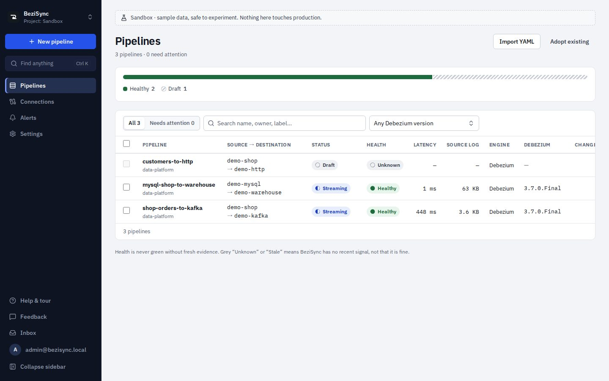

# BeziSync documentation

BeziSync is a self-service control plane for change data capture: platform teams connect runtimes
and set guardrails once; anyone can then stream changes from a database to a destination safely.
Each pipeline runs on one of two engines, [Debezium Server](https://debezium.io/documentation/reference/stable/operations/debezium-server.html)
or [Flink CDC](https://nightlies.apache.org/flink/flink-cdc-docs-stable/). These pages cover
installing, using and operating it.

## Start here

- [Install](guide/install.md) — Try BeziSync on Docker in two minutes, or install it on Kubernetes with the Helm chart for production.
- [Run your own lab in GitHub Codespaces](guide/codespaces-lab.md) — A private BeziSync with more sources, destinations and teammates, in your own codespace.
- [Concepts](guide/concepts.md) — Projects, runtimes, connections, pipelines, engines, health and roles.
- [Your first pipeline](guide/your-first-pipeline.md) — From an empty project to a deployed pipeline, step by step: runtime, connections, the wizard and the first deploy.
- [Choose an engine](guide/choose-an-engine.md) — Debezium Server or Flink CDC: which sources and destinations each runs, and how to pick.

## Build pipelines

- [Sources](guide/sources.md) — The databases BeziSync reads, their readiness checks and what each one supports.
- [Destinations](guide/destinations.md) — What every destination shares: naming, formats, event shapes and checks.
- [Event streams and queues](guide/destinations-events.md) — Kafka, Pub/Sub, Kinesis, SQS, SNS, Event Hubs, Pulsar, Redis Streams, NATS and HTTP.
- [Databases](guide/destinations-databases.md) — A live copy of tables in PostgreSQL, MySQL, MariaDB, SQL Server or OceanBase.
- [Lakehouse tables](guide/destinations-lakehouse.md) — Apache Iceberg, Apache Paimon and Apache Fluss tables kept in sync with the source.
- [Analytics and search](guide/destinations-analytics.md) — StarRocks and Apache Doris tables for real-time analytics, and Elasticsearch indexes, kept in sync on Flink CDC.
- [Shape events (transforms)](guide/shape-events-transforms.md) — Filters, renames, routes, keys and computed columns, previewed before deploy.
- [Personal data](guide/personal-data.md) — Find personal columns when you pick a table, then mask, remove or keep each one, per pipeline and audited.
- [Databases behind a bastion (SSH)](guide/databases-behind-a-bastion-ssh.md) — Reach a source database through an SSH jump host, with the key stored encrypted and the host key pinned.

## Run and operate

- [Operate](guide/operate.md) — The pipeline page, changes and rollbacks, snapshots, the delivery canary, schema changes and alerts.
- [Engine versions](guide/engine-versions.md) — The Debezium and Flink CDC images pipelines run, and upgrading them.
- [Flink CDC engine](guide/flink-cdc-engine.md) — Set up and run the second engine: images, clusters, saved positions and restores.
- [Adopt an existing Debezium Server](guide/adopt-an-existing-debezium-server.md) — Turn a Debezium Server you already run into a BeziSync pipeline.

## Runtimes

- [Manage runtimes](guide/manage-runtimes.md) — Add Kubernetes namespaces and Docker hosts where pipelines run, test them, and name the places pipelines may run in them.
- [Remote runtimes (agents)](guide/remote-runtimes-agents.md) — Run pipelines where BeziSync can't reach, through an outbound-only agent.
- [Google GKE and Amazon EKS](guide/google-gke-and-amazon-eks.md) — Managed Kubernetes through an agent or with a cloud identity.

## Administer

- [Administration](guide/administration.md) — Settings for Admins: people, projects, feedback, sign-in and the audit log of every change in BeziSync.
- [Guardrails: policies, approvals, templates](guide/guardrails-policies-approvals-templates.md) — What each project may run, which changes need someone to approve them, and the templates people start from.
- [Secrets and secret stores](guide/secrets-and-secret-stores.md) — Encrypted, write-only secrets, or references to Vault, AWS, Google and Kubernetes stores.
- [Single sign-on](guide/single-sign-on.md) — Sign in with OpenID Connect, OAuth2 or SAML providers set up in Settings, with groups mapped to project roles.
- [Configuration reference](guide/configuration-reference.md) — Every environment variable the BeziSync server reads, with its default and what it does.

## Automate

- [Config-as-code and the CLI](guide/config-as-code-and-the-cli.md) — Pipelines as YAML in git, checked and applied from CI with the bezisync CLI and personal API tokens.
- [AI agents (MCP)](guide/ai-agents-mcp.md) — Let AI agents build and operate pipelines with exactly their person's permissions.

## Reference

- [Preflight checks](reference/checks.md) — Every check BeziSync runs before a pipeline deploys, with why it matters and the fix. Generated from the source.
- [Threat model](security/threat-model.md) — What BeziSync protects, from whom, and the risks an operator must handle.
- [Architecture decisions](adr/README.md) — The design decisions behind BeziSync, as ADRs.
