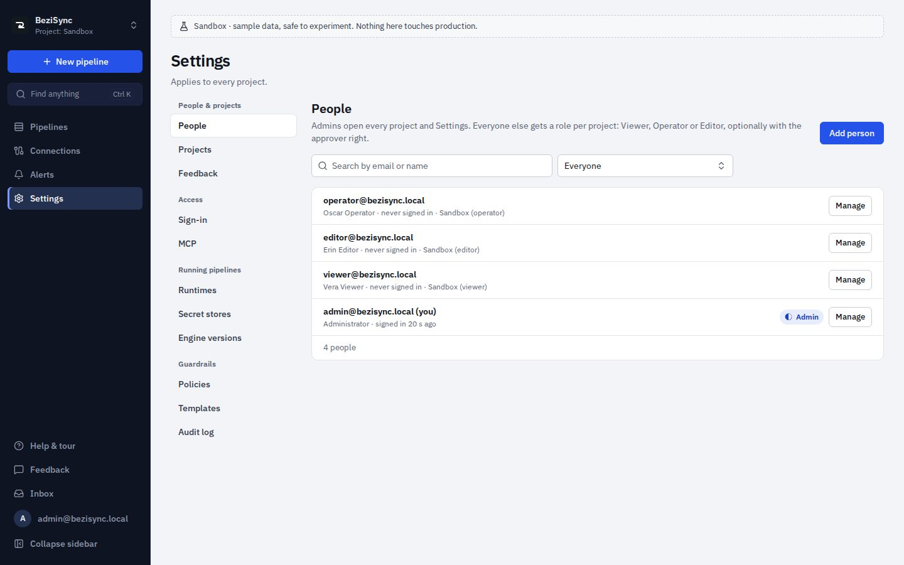

# Administration

Admins run BeziSync from **Settings**: people and projects, sign-in, runtimes, engine versions,
policies and the audit log. This page covers people, projects and the day-to-day jobs of running
the server.

## Where to find it

**Settings** is for Admins only. It is grouped by job:

- *People & projects*
- *Running pipelines*: runtimes, secret stores, engine versions
- *Guardrails*: policies, templates, audit log

Sections that belong to one project show which project at the top, with a picker to switch.
Links to the former `/admin/…`, Members and Pipeline images pages redirect to their new place.

## Manage people

**People** lists every account, local and SSO (single sign-on). It is the one place for access.

- **Add a person** with a role in a project, or as Admin. Leave the password empty for SSO users:
  the account links to their identity by email at their first sign-in.
- **See who can open a project**: filter by **Can open <project>**. The list shows its members
  and every Admin, and you can change their access there.
- **Manage** shows one person across all projects. From there you can make them Admin or
  deactivate the account.

Deactivating signs the person out everywhere and stops their API tokens from working.
Reactivating restores access.

You cannot demote or deactivate yourself, and the last Admin is protected.

## Manage projects

**Projects** lists each project with its member and pipeline counts. Create, rename and delete
projects here; **People** on a row opens who can open that project.

A project with pipelines cannot be deleted. Delete its pipelines first, so their connectors and
source objects are cleaned up.

## Read feedback

**Feedback** collects what people send with **Feedback** at the bottom of the sidebar: something
broken, a security issue, an idea or anything else. Each report comes with the page the person
was on and their browser.

1. Filter by open or resolved, and by type.
2. Open a report to read it in full.
3. **Reply by email**, or **Mark resolved** (you can reopen it later).

Every Admin gets an inbox entry per report, in the project the report came from. They can mute
these under *Notification settings*.

Anyone signed in can send up to 10 reports an hour; API tokens cannot send any. Messages are
shown as plain text and never reach the audit log.

## Export the audit log

Open **Settings → Audit log** and export it as CSV or JSON Lines.

## Monitor the server

| Endpoint | What it is |
|---|---|
| `GET /metrics` | Prometheus metrics, served when `BEZISYNC_METRICS_TOKEN` is set |
| `/healthz`, `/readyz` | Health and readiness checks |

## Rotate the master key

1. Set the new key as `BEZISYNC_MASTER_KEY`.
2. Put the old one in `BEZISYNC_PREVIOUS_MASTER_KEYS`.
3. Restart.
4. Run `bezisync rotate-master-key`.

Sessions and tokens move to the new key when they are used. Remove the old key once users have
signed in again and tokens were used or re-issued.

## Turn on telemetry

Telemetry is off by default. With `BEZISYNC_TELEMETRY_ENABLED=true` and `BEZISYNC_TELEMETRY_URL`
set, the controller sends anonymous aggregate counts weekly.

Instance admins can preview the exact payload at `GET /api/v1/system/telemetry`.

## Uninstall

1. Run `bezisync uninstall`. It prints everything BeziSync created on sources and runtimes.
2. Run `bezisync uninstall --yes [--drop-destinations]`. It removes those items and reports each
   one.
3. Delete BeziSync and its database.

## Version and licenses

**Help & tour → About BeziSync** shows the server version and the license (Apache 2.0).

BeziSync ships the licenses and notices of everything it includes. Each list starts with
BeziSync's own NOTICE and LICENSE:

| Where | What |
|---|---|
| `/licenses.txt` | The web UI's licenses |
| `GET /api/v1/system/licenses` | The server's licenses (public, plain text) |
| `bezisync licenses` | The server's licenses, from the CLI |
| `LICENSES.txt` | In each CLI archive |

Debezium Server is a separate project under its own license and is not included.

## Upgrading from per-project admins

When you upgrade from a version with per-project admins, each project admin becomes an editor
with the approver right in that project (never an Admin). Make people Admins under **People** as
needed.

---

[All documentation](../README.md)
