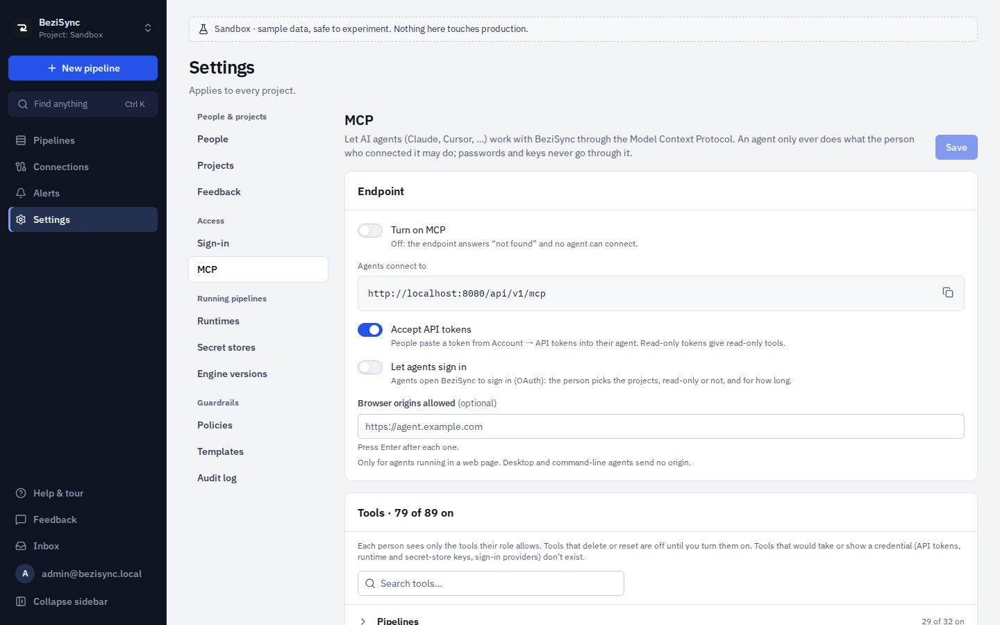

# AI agents (MCP)

BeziSync speaks the [Model Context Protocol](https://modelcontextprotocol.io) (MCP), so AI agents
can list, build, check, deploy and operate pipelines for people, with exactly their person's
permissions and never a credential.



Supported agents include Claude Code, Claude Desktop, ChatGPT, Codex, Gemini CLI, Cursor, VS Code
and Windsurf.

| Where | Who | What |
|---|---|---|
| **Settings → MCP** | Admins | Turn MCP on, choose the ways in, manage agents and tools |
| **Account → AI agents** | Everyone | How to connect your agent |

## Connect an agent

1. An Admin turns MCP on in **Settings → MCP**. The endpoint is `<public URL>/api/v1/mcp`
   (Streamable HTTP).
2. Open **Account → AI agents** and pick your agent. It shows that client's own command or
   config. ChatGPT signs in only; the rest also take an API token.

For example:

```sh
claude mcp add --transport http bezisync https://bezisync.example.com/api/v1/mcp
```

## Two ways in

Each way can be switched on or off in **Settings → MCP**.

### Sign in (OAuth 2.1)

1. The agent finds BeziSync's authorization server from the endpoint's `401`
   (`/.well-known/oauth-protected-resource`), registers itself, and opens BeziSync in the browser.
2. The person picks which projects it may open (one or all of theirs), whether it may only read,
   and for how long. An Admin sets the maximum.

New agents can be usable at once or wait for an Admin. People see and disconnect their agents
under **Account**. Admins see every agent and connection in **Settings → MCP**, and can block or
remove an agent.

### API tokens

Put a token from **Account → API tokens** in the agent's `Authorization: Bearer` header.

| Token | Gives the agent |
|---|---|
| Read-only | Read-only tools |
| Project-scoped | One project |
| Revoked | Disconnects the agent |

The dialog that shows a new token once also shows the Claude Code command with the token filled
in, and **Account → AI agents** has the steps under **API token**:

```sh
claude mcp add --transport http bezisync https://bezisync.example.com/api/v1/mcp \
  --header "Authorization: Bearer bzt_…"
```

Clients configured with JSON (Cursor, VS Code, Windsurf, Claude Desktop through `mcp-remote`, …)
take the same header. Codex reads it from an environment variable (`--bearer-token-env-var`). The
generic form:

```json
{
  "mcpServers": {
    "bezisync": {
      "type": "http",
      "url": "https://bezisync.example.com/api/v1/mcp",
      "headers": { "Authorization": "Bearer bzt_…" }
    }
  }
}
```

### Check a token

List the tools a token may use:

```sh
curl -s https://bezisync.example.com/api/v1/mcp -H "Authorization: Bearer bzt_…" \
  -H "Content-Type: application/json" -H "Accept: application/json, text/event-stream" \
  -d '{"jsonrpc":"2.0","id":1,"method":"tools/list"}'
```

## Tools follow the person

Each request only lists the tools the person's live roles allow: an Editor gets no Admin tools, a
viewer no write tools.

Every tool calls BeziSync's own API as that person. Permissions, validation, policies, approvals
("deploy" asks for approval where required) and the audit log work exactly as in the app. The
audit log's actor reads `email (token MCP · <agent>)`.

Tools that delete or reset (delete a pipeline, reset offsets, …) are off until an Admin turns them
on. Admins can turn any tool off.

## No credentials

No tool takes or returns a password, key or token. These are left to people in the app:

- creating API or agent tokens;
- runtime, secret-store and alert-channel credentials;
- sign-in providers and passwords;
- the MCP settings themselves.

A connection's secret fields can only be secret-store references (`ref+vault://…`). Event previews
always mask personal data.

---

[All documentation](../README.md)
