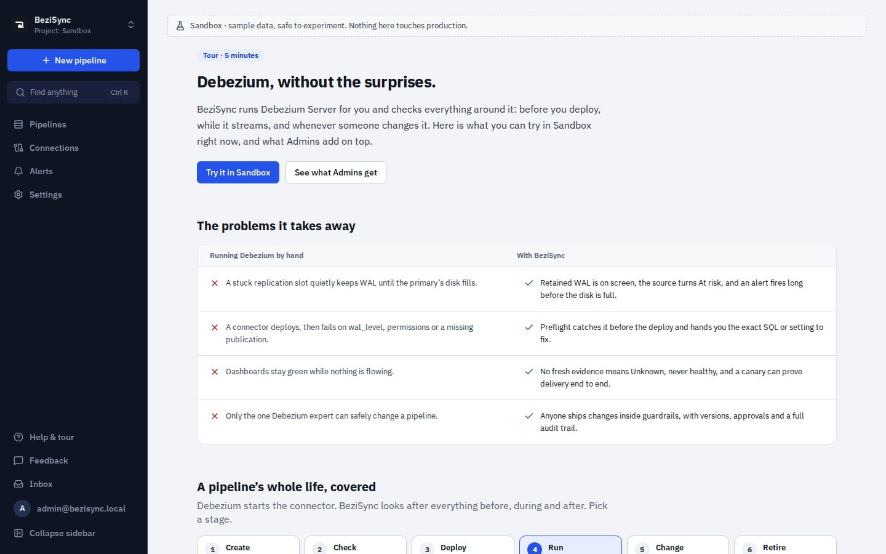

# Concepts

Five ideas carry everything else in BeziSync: projects, runtimes, connections, pipelines and the
engine that runs each pipeline. Health and roles sit on top of them.

## The building blocks

| Term | Meaning |
|---|---|
| **Project** | An isolation boundary (for example `staging` or `prod`) with its own members, runtimes, connections, pipelines and policies |
| **Runtime** | Where connectors run: a Kubernetes namespace or a Docker host, directly or through an [agent](remote-runtimes-agents.md) |
| **Connection** | A reusable [source](sources.md) or [destination](destinations.md), with its credentials stored encrypted |
| **Pipeline** | One source → one destination, with its tables, format, transforms and settings. Every saved change is a **version**; deploying runs one version |
| **Engine** | What runs a pipeline: **Debezium** (one Debezium Server) or **Flink CDC** (a small Flink cluster). Chosen per pipeline in the Destination step and fixed at its first deploy; see [Choose an engine](choose-an-engine.md) |
| **Health** | Healthy · Lagging · At risk (source impact) · Down · Unknown. Never green without fresh evidence |

Sources: PostgreSQL, MySQL/MariaDB, SQL Server, MongoDB, Oracle, CockroachDB, Vitess and Google
Cloud Spanner. Destinations: Kafka, HTTP, Pub/Sub, Kinesis, Redis Streams, NATS JetStream, Apache
Iceberg, PostgreSQL / MySQL / MariaDB / SQL Server through JDBC, Amazon SQS, Amazon SNS, Azure Event
Hubs, Apache Pulsar, StarRocks, Apache Doris, Apache Fluss, Elasticsearch, Apache Paimon and
OceanBase.

## Roles

**Admin** is account-wide: Admins open every project with every permission and are the only ones
who see **Settings** (people, projects, runtimes, engine versions, policies). Everyone else gets a
role per project:

| Role | Can |
|---|---|
| Viewer | See the project's pipelines, connections and health |
| Operator | Also pause and resume pipelines and preview data |
| Editor | Also create, deploy and upgrade pipelines and connections |

"Can approve" is a separate per-project right; see [Guardrails](guardrails-policies-approvals-templates.md).

## Your account and help

Everyone has **Account** (user menu) for their name, theme (System, Light or Dark, also in the
user menu), Guided/Expert mode, notifications and personal API tokens. Long lists show 20 rows a
page; the rows-per-page choice under each list (10 to 100) applies to every list in that browser.

**Help & tour** (bottom of the sidebar) opens:

- the **Tour**: what BeziSync does across a pipeline's life, what to try in the project, and what
  Admins get. Its closing "Would your team use BeziSync?" answer reaches the Admins as feedback;
- **Getting started**;
- **Learn**: Debezium terms in plain words;
- search.

New members see a dismissible "New here?" card until they open the Tour.

---

[All documentation](../README.md)
