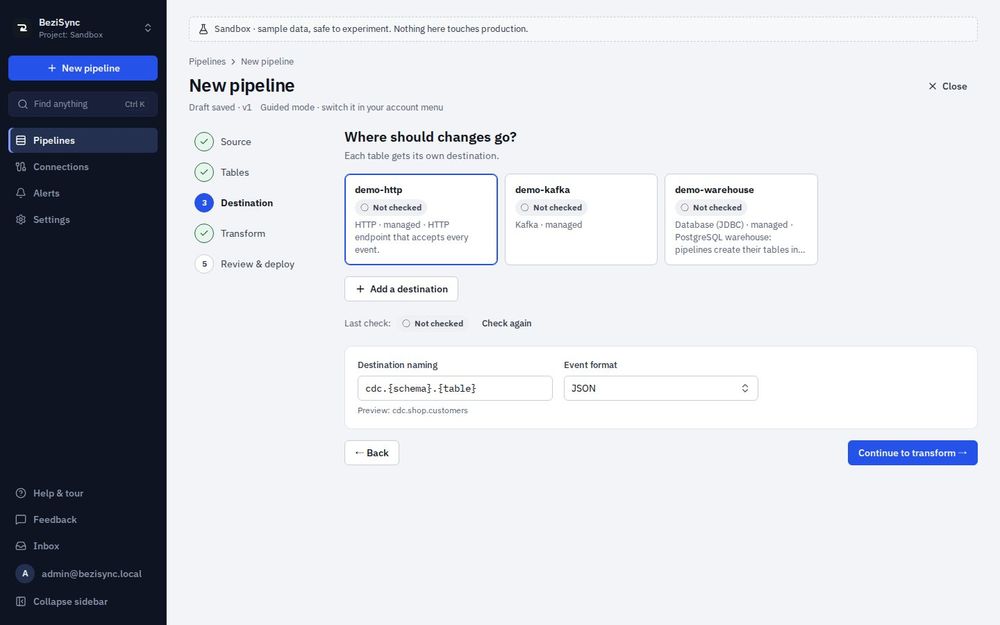

# Destinations

A destination is where a pipeline writes the changes it captures. This page lists every
destination BeziSync supports, which engine writes it, and what all of them have in common.

## What every destination shares

Each destination states what it needs from a pipeline, and the wizard's Destination step only
offers that:

- the names it accepts, with a live preview;
- its event formats;
- the event shape it requires;
- its own pipeline settings;
- the smallest connector size it runs in.

Preflight checks the rest. Every destination's checks and their fixes are in the
[preflight check reference](../reference/checks.md).

## All destinations

Destinations are grouped by what they are for: event streams and queues (Kafka to HTTP),
databases (JDBC, OceanBase), lakehouse tables (Iceberg, Paimon, Fluss), analytics (StarRocks,
Doris) and search (Elasticsearch). Kafka and Iceberg take both engines, Debezium by default.
StarRocks, Doris, Fluss, Elasticsearch, Paimon and OceanBase run only on Flink CDC. The rest run
only on Debezium.

| Destination | Page | Engine |
|---|---|---|
| [Kafka](destinations-events.md#kafka) | Event streams and queues | Debezium (default) or [Flink CDC](destinations-events.md#kafka-on-flink-cdc) |
| [Google Pub/Sub](destinations-events.md#google-pubsub) | Event streams and queues | Debezium |
| [AWS Kinesis](destinations-events.md#aws-kinesis) | Event streams and queues | Debezium |
| [Amazon SQS and Amazon SNS](destinations-events.md#amazon-sqs-and-amazon-sns) | Event streams and queues | Debezium |
| [Azure Event Hubs](destinations-events.md#azure-event-hubs) | Event streams and queues | Debezium |
| [Apache Pulsar](destinations-events.md#apache-pulsar) | Event streams and queues | Debezium |
| [Redis Streams](destinations-events.md#redis-streams) | Event streams and queues | Debezium |
| [NATS JetStream](destinations-events.md#nats-jetstream) | Event streams and queues | Debezium |
| [HTTP](destinations-events.md#http) | Event streams and queues | Debezium |
| [Database (JDBC)](destinations-databases.md#database-jdbc): PostgreSQL, MySQL, MariaDB, SQL Server | Databases | Debezium |
| [OceanBase](destinations-databases.md#oceanbase) | Databases | Flink CDC |
| [Apache Iceberg](destinations-lakehouse.md#apache-iceberg) | Lakehouse tables | Debezium (default) or Flink CDC |
| [Apache Paimon](destinations-lakehouse.md#apache-paimon) | Lakehouse tables | Flink CDC |
| [Apache Fluss](destinations-lakehouse.md#apache-fluss) | Lakehouse tables | Flink CDC |
| [StarRocks](destinations-analytics.md#starrocks) | Analytics and search | Flink CDC |
| [Apache Doris](destinations-analytics.md#apache-doris) | Analytics and search | Flink CDC |
| [Elasticsearch](destinations-analytics.md#elasticsearch) | Analytics and search | Flink CDC |

Each destination on those pages is described in the same order, so you can compare them: the
engine, what you get, the connection, the pipeline settings and formats, what preflight checks,
how BeziSync reads it back, what deleting a pipeline does, and the limits.

[Choose an engine](choose-an-engine.md) compares the engines.

---

[All documentation](../README.md)
