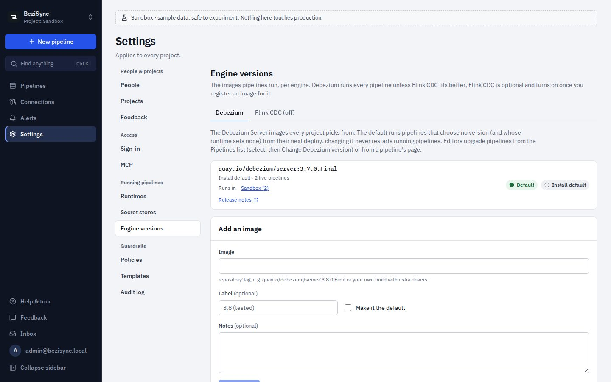

# Engine versions

This page lists the images each engine runs, and is where you upgrade pipelines from one Debezium
Server version to the next.

**Settings → Engine versions** is for Admins. It has two tabs, **Debezium** and **Flink CDC**.
Version counts, the version column and bulk moves are for Debezium pipelines. Upgrading pipelines
is done by editors, on the **Pipelines** list (see [Upgrade pipelines](#upgrade-pipelines)).

## Manage Debezium Server images

The **Debezium** tab is the one list of Debezium Server images every project picks from. For each
image it shows how many pipelines run it per project; each count links to that project's
Pipelines list filtered to that version.

- The install default (`BEZISYNC_DEBEZIUM_DEFAULT_IMAGE`) is always listed.
- Add releases or your own builds (extra converters, SMTs or drivers) with a label and notes.
- Make one the **default**. It overrides the install default; **Use install default** goes back.
- Deprecate or remove images.

Making an image the default, or going back to the install default, asks first and says how many
live pipelines run the current default. A new default never restarts running pipelines: they show
it as their next deploy.

The catalog is advice, not enforcement. Pipelines on a deprecated or unlisted image keep running
and get a non-blocking `debezium_image_deprecated` / `debezium_image_unlisted` check.

## Manage Flink CDC images

On the **Flink CDC** tab, Admins add, label, deprecate and remove images and choose the default.
Pipelines that pin no image (`flinkCdcImage` in YAML) run the default from their next deploy;
running pipelines are not restarted.

Flink CDC is off until the tab lists an image (see [Flink CDC engine](flink-cdc-engine.md)).

## Upgrade pipelines

Upgrading is pipeline work, done by editors where pipelines live.

1. On the **Pipelines** list, use the *Debezium* column and version filter to find the pipelines.
2. Select pipelines and choose **Change Debezium version…**.
3. Pick an offered version, any other image, or back to the default. Pipelines that already follow
   the default are redeployed when it changed.
4. Before you confirm, read what the release does to each pipeline's settings (see below).

Change one pipeline first, watch it reach Healthy, then the rest. Each change is a new version, so
rollback is deploying the previous one.

A pipeline's flow strip shows the version it runs and why: chosen for this pipeline, the
runtime's default, or the default. Its **Change** button changes just that pipeline.

What the dialog says about each pipeline's settings:

| Setting | Effect of the change |
|---|---|
| A tuned setting the release doesn't have | Refuses that pipeline's change until you remove it |
| A renamed setting | Moves to its new key |
| Raw properties | Listed as not checked |

## Details

### Iceberg pipelines

Destinations the official images lack run their own Debezium Server build, pinned by digest.
Apache Iceberg pipelines run `ghcr.io/memiiso/debezium-server-iceberg` (built on Debezium 3.6,
amd64 only), whatever the runtime or catalog default.

- The Pipelines list shows it as "Iceberg sink <version>".
- A pipeline may pin another tag of that build, never an official image (`422 image_family`).
- Point `BEZISYNC_ICEBERG_IMAGE` at a mirror for private registries.
- Preflight blocks a runtime whose nodes are all another architecture and warns when only some
  are (`sink_image_platform`).

---

[All documentation](../README.md)
