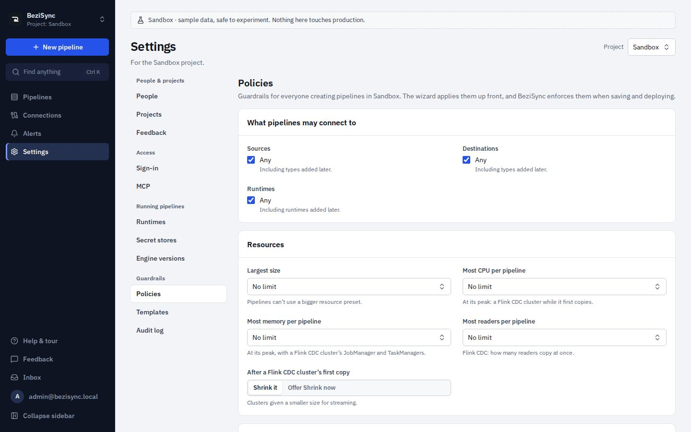

# Guardrails: policies, approvals, templates

Guardrails let Admins decide once what a project may do (runtimes, types, sizes, engines), which
changes need approval, and which templates people start from.

**Settings → Policies** is for Admins, and is set per project.

## How policies apply

- The page groups policies by what you decide, and refuses an empty allow-list.
- Before you save, it lists the running pipelines whose next deploy the change would block.
- The wizard applies policies up front: disallowed options stay visible and say why.
- The server enforces policies when a pipeline is saved and when it deploys.

## What a policy controls

| Policy | What you decide |
|---|---|
| Allowed runtimes | Which runtimes pipelines may run on |
| Allowed types | Which source and destination types pipelines may use |
| Snapshot modes | Which snapshot modes are allowed |
| **Resources** | Sizes and peak CPU, memory and readers; see [Resources](#resources) |
| **Setting limits** | Bounds on typed engine settings; see [Setting limits](#setting-limits) |
| Pipelines per source | How many pipelines may read one source (each holds a replication slot or log reader) |
| "Deploy anyway" | Whether the option exists |
| **Approval** | Whether deploys need approval; see [Approvals](#approvals) |
| Transform types | Which transform types pipelines may use |
| **Custom transforms** | Whether pipelines may use any SMT class in the image. Off by default |
| **Scripted transforms** | Whether pipelines may use Groovy/JavaScript filter scripts, which run next to the connector's credentials. Off by default |
| **Advanced Debezium properties** | Whether pipelines may set raw properties BeziSync can't verify. Off by default |

Upgrading to the release that added the advanced-properties policy turned it on for every project
that already had a pipeline using them, with an audit entry, so nothing that deployed before is
blocked.

## Resources

- **Largest preset size.** A custom size is held to that preset's CPU and memory. A custom Flink
  CDC cluster is held to the totals of the Flink CDC preset of that name.
- **Peak limits.** The most CPU, memory and readers one pipeline may ask for at its peak:
  `resource_limits: {max_cpu, max_memory, max_parallelism}`. A Flink CDC cluster's peak is its
  first copy. The limits can be no lower than Small, or nothing could deploy.
- **Shrinking.** Whether clusters shrink after their first copy, or only offer Shrink now.

## Setting limits

For each typed setting, a limit can be one of:

| Limit | Effect |
|---|---|
| At most / at least a value | The setting must stay within it |
| Only some choices | Other choices are refused |
| Always a value | Written into each pipeline's version when it deploys; Review shows it as set by project policy |
| Hidden | The setting is not offered |

A limit is checked against the setting when you add it, and the pipelines it would block are
counted before you save.

- A pipeline over a limit keeps running; its next deploy is blocked (`policy_setting_limit`).
- Promote's plan names what a target project's limits refuse.
- A limit on a setting BeziSync no longer offers is shown as obsolete and ignored.

## Approvals

With approval required, deploying (including rollbacks and image moves) creates a request with the
preflight result.

Another member with approval rights approves it from the pipeline page (preflight runs again), or
rejects it with a comment.

Nobody approves their own request.

## Templates

**Templates** (History → Save as template) let teams start from agreed settings. A template
captures a destination, runtime, format, transforms, size and snapshot mode.

It never captures tables, column rules, message keys or steps limited to some tables.

## When policies can't be read

If a project's stored policies can't be read (for example a value an older or newer release wrote
that this one refuses), BeziSync fails closed:

- The page lists what couldn't be read.
- Those fields show their strictest setting; the rest keep what was saved.
- Every change to the project's pipelines is refused with `policy_unreadable` until an Admin
  fixes the fields and saves. That includes saving a changed spec, creating and deploying, even
  with Deploy anyway.

Running pipelines keep running, and pause, resume and delete still work.

---

[All documentation](../README.md)
