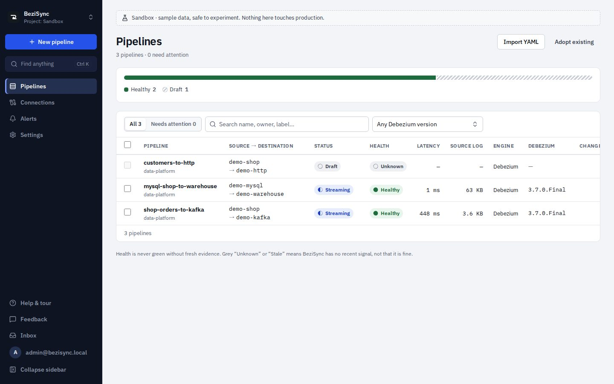

# Install

BeziSync is one Go binary (API, controller, agent, CLI) and a web UI, with PostgreSQL as its only
dependency. Try it on Docker in two minutes, or install it on Kubernetes with the Helm chart.

## Try it on Docker

```bash
git clone https://github.com/daun-gatal/bezisync && cd bezisync
docker compose -f deploy/compose/docker-compose.yml up -d --build
```

Open <http://localhost:8080> and sign in as `admin@bezisync.local` / `bezisync-demo`. The
**Sandbox** project is wired to a sample shop database with live orders, Kafka and a local Docker
runtime.



To try more sources and destinations without installing anything, [run your own lab in GitHub
Codespaces](codespaces-lab.md).

## Install on Kubernetes

The charts are published as OCI artifacts:

```bash
helm install bezisync oci://ghcr.io/daun-gatal/charts/bezisync --version <version> \
  -n bezisync --create-namespace -f my-values.yaml
```

For production, set in `my-values.yaml`:

- **An external, highly available PostgreSQL**: `secrets.databaseUrl`, or `existingSecret`.
- **A master key**: generate it with `bezisync generate-master-key` and keep it; it decrypts the
  stored secrets.
- **An `https` `publicUrl`** and `cookieSecure: true`.

Production refuses to start with development keys, insecure cookies or a non-https public URL,
unless `allowPlainHttp: true` says the network itself encrypts traffic (for example a Service
exposed only on a Tailscale tailnet).

The controller can run connectors in the namespaces listed in `kubernetesRuntime.namespaces`
(direct mode). Other useful values:

| Value | What it does |
|---|---|
| `imagePullSecrets` | Pull secrets for the BeziSync images |
| `service.annotations`, `service.loadBalancerClass` | Expose the Service, for example through the Tailscale operator |
| `postgres.storageClass` | Storage of the bundled PostgreSQL |
| `ingress.*` | An Ingress in front of the UI and API |
| `appArmorProfile` | An AppArmor profile for every pod of the chart, for example `{ type: Localhost, localhostProfile: bezisync-default }` |

[`deploy/apparmor/`](../../deploy/apparmor/kustomization.yaml) (`kubectl apply -k deploy/apparmor`)
loads one at every boot, for kernels whose default containerd profile blocks signals inside
containers.

### Versions and upgrades

The charts install the `latest` release images by default (`image.tag` / `webImage.tag`, pulled
with `pullPolicy: Always`). Pin `image.tag` and `webImage.tag` to a release (for example `0.1.0`)
for reproducible upgrades.

The images (`X.Y.Z`, for linux/amd64 and linux/arm64) and the CLI share the release version. Each
chart has its own version (`helm show chart oci://ghcr.io/daun-gatal/charts/bezisync` shows it) and
installs the release it was published with. Every release lists its chart versions. Verify what
you pull with `gh attestation verify oci://ghcr.io/daun-gatal/bezisync:X.Y.Z --owner daun-gatal`.

### Private registry

To install from a mirror or a private registry, push the images there and create an image pull
secret for the cluster:

```bash
kubectl create secret docker-registry ghcr-pull-secret --docker-server=<registry> \
  --docker-username=<user> --docker-password=<token>
```

List it in `imagePullSecrets` of both charts (and in a runtime's *image pull secrets* when
connectors use a private image), and point `image.repository` and `webImage.repository` at it.

## PostgreSQL is on the data path

PostgreSQL holds BeziSync's metadata **and** each connector's offsets and schema history (the
`debezium_state` schema, or `BEZISYNC_STATE_DATABASE_URL`). It is on the data path: run it highly
available and back it up.

## Next

- [Concepts](concepts.md): projects, runtimes, connections and pipelines.
- [Your first pipeline](your-first-pipeline.md).
- [Configuration reference](configuration-reference.md): the server's main settings.

---

[All documentation](../README.md)
