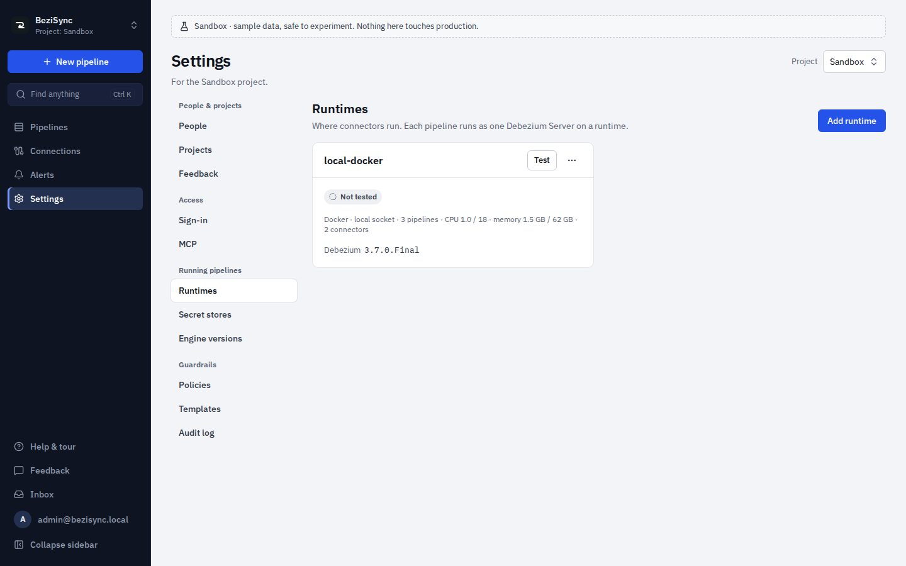

# Manage runtimes

A runtime is where pipelines run: a Kubernetes namespace or a Docker host, reached directly or
through an agent.

**Settings → Runtimes**, Admins only. Pick the project at the top: it changes which project the
section shows, not the project you are in.

## Add a runtime

**Add runtime** adds a Kubernetes namespace or a Docker host. To add one that BeziSync cannot reach
directly, see [Remote runtimes (agents)](remote-runtimes-agents.md).

## Runtime actions

Each runtime's **More actions** menu has:

| Action | What it does |
|---|---|
| **Edit** | Change the name, settings, credentials and the default Debezium image. Credentials are write-only: leave a secret empty to keep it |
| **Placement profiles** (Kubernetes, in Edit) | Named places pipelines may run ([below](#placement-profiles)) |
| **Disable / Enable** | Disabling *cordons* the runtime ([below](#disable-a-runtime)) |
| **Delete** | Remove the runtime once nothing uses it ([below](#delete-a-runtime)) |

When you edit a runtime:

- Changing where a runtime points needs its running pipelines paused first.
- Pipeline manifests refer to runtimes by name, so update them after a rename.

## Placement profiles

A placement profile is a named place pipelines may run on a Kubernetes runtime. Docker runtimes
have none. A profile holds:

- a node selector;
- tolerations;
- a priority class;
- pod labels.

Values are taken as they are: no `${…}` or `{{…}}`, Kubernetes label names, and BeziSync's own
labels can't be set.

A pipeline picks a profile in Review (`spec.placement`). It keeps the profile it deployed with
until its next deploy, so editing a profile restarts nothing.

Details:

- A profile in use can't be removed; the error names its pipelines.
- Preflight's `placement` check blocks a profile no schedulable node takes, or an agent too old to
  apply it.
- A custom Flink CDC cluster is packed for the largest node the profile can use.

## Disable a runtime

Disabling *cordons* the runtime:

- Pipelines already on it keep running, and can still be paused, resumed, restarted and
  snapshotted.
- Nobody can create, move or deploy pipelines onto it (a blocking `runtime_disabled` check).

Disabling and enabling are both audited.

## Delete a runtime

You can delete a runtime once no pipeline uses it (move or delete them first) and deleted
pipelines have finished cleaning up. Their history stays. Deleting an agent runtime revokes its
token.

## Connector images

On a Docker runtime, BeziSync downloads a Debezium image the host does not have yet in the
background. The pipeline shows **Downloading the connector image…** and starts once the download
finishes. When it replaces a running connector, it keeps streaming on the old version with a note.

| Setting | Range | Default |
|---|---|---|
| **Image download timeout**: bounds one download | 10 minutes to 2 hours | 30 minutes |

A Docker agent takes the timeout from `BEZISYNC_AGENT_DOCKER_IMAGE_PULL_TIMEOUT` (the install
command sets it).

On Kubernetes the node downloads images. A failed attempt only fails the pipeline once Kubernetes
gives up retrying (`ImagePullBackOff`).

### Changing the default image

The image a pipeline runs is fixed when it is deployed. Changing a runtime's (or the install's)
default image never restarts running pipelines. They pick it up at their next deploy, which their
pipeline page shows as "next deploy".

---

[All documentation](../README.md)
