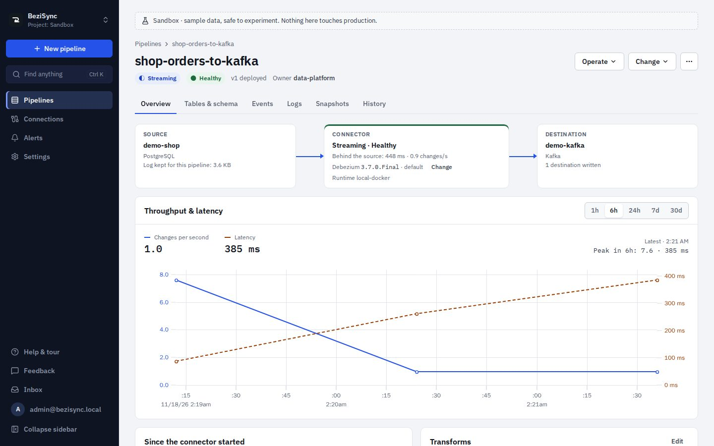
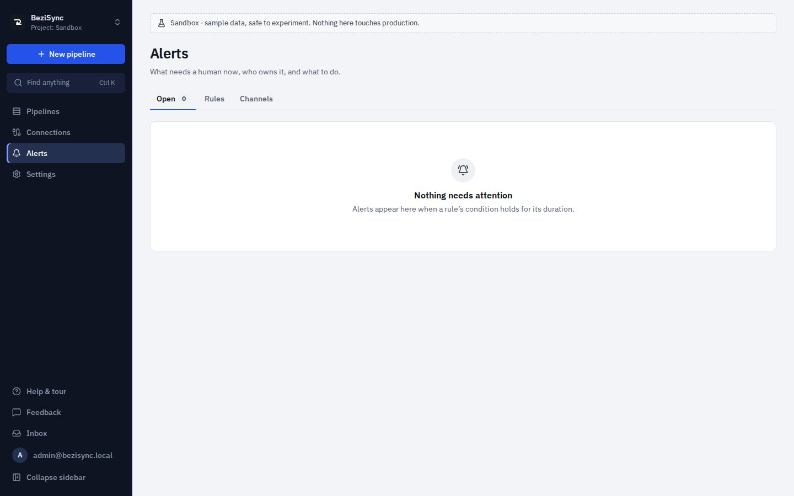

# Operate

Everything you do with a running pipeline happens on its page: watch its health, change it, pause
it, re-copy tables and get alerted.

## The pipeline page

The pipeline page opens on **Overview**. From top to bottom it shows:

| Part | What it shows |
|---|---|
| Flow strip | Source → connector → destination: the log kept on the source for this pipeline (for MongoDB, how far back the shared oplog reaches), the connector's state, lag, throughput, Debezium version and runtime, and what is written at the destination |
| Throughput and latency chart | Full width: the latest values, or the values at the point you hover, and the peak over the range |
| Counters | Totals since the connector started |
| **Source protection** | How much room the pipeline has on the source, in the source's own terms ([below](#source-protection)) |
| **Transforms** | The deployed transforms ([below](#transforms)) |
| Delivery | End-to-end delivery, beside source protection and transforms |

The other tabs:

| Tab | What it holds |
|---|---|
| **Tables & schema** | The pipeline's tables and their schema |
| **Events** | Events read back from the destination, masked |
| **Logs** | The pipeline's logs |
| **Snapshots** | Re-copy rows, and the stored position |
| **History** | Versions, the generated configuration, Export YAML, Promote, Save as template, and the activity |

The header has one primary button that follows the pipeline's state: **Continue setup**,
**Review and deploy**, **Resume** or **Restart**. **Operate**, **Change** and **More actions** hold
everything else.

### Source protection

Source protection shows how much room the pipeline has before the source drops changes it hasn't
read yet. Each measure is set against how far the stored position is behind, with a bar of the
window used.

| Source | What it shows |
|---|---|
| PostgreSQL | The replication slot, its WAL status and the room left before `max_slot_wal_keep_size` invalidates it ("No cap" when that is -1) |
| MySQL | The binlog file the pipeline reads and whether the next purge would remove it |
| MongoDB | The oplog window and how full the oplog is |
| SQL Server | How long CDC keeps changes (the cleanup job's retention), whether the pipeline's position is still inside that window, and the transaction log's fill |
| Oracle | How far back the archived logs reach |
| CockroachDB | The tables' GC TTL |
| Spanner | The change stream's retention |
| Vitess | *Unknown*: binlog retention is not visible through VTGate |

For PostgreSQL and MySQL, a bar shows the log kept for this pipeline against the pipeline's
*source retained limit* policy (10 GB by default). Anything the probe could not measure says
*Unknown* or *Not measured yet*, never fine.

### Transforms

The **Transforms** card first shows what consumers receive:

- the row after the change, or the full envelope;
- how deletes arrive;
- the extra fields, with their names;
- value formats and custom message keys.

Then it lists the steps that change events on the way (filters, renames, added fields, …). Side by
side with other cards, it is as tall as they are and scrolls when the steps need more room.

## Pause / Resume / Restart

Pause, resume and restart a pipeline from **Operate**. While a pipeline is paused, the source keeps
retaining changes for it, so watch source protection.

## Change a pipeline

**Change** edits one part of a pipeline: tables, destination, transforms or settings.

1. Open **Change** and edit the part. Your edits become one new version: every save while you edit
   updates that version, until it is deployed or sent for approval.
2. Review shows the diff and what deploying will do. Added tables are back-filled with an
   incremental snapshot, and some changes restart the connector.

### Roll back

Deploy any earlier version from **History**. The confirmation lists the restart, the changes and
whether approval is needed.

### Discard a saved change

To drop a change you saved but don't want to deploy:

- use **Discard vN** on the "vN is saved but not deployed" notice, or
- close the wizard, which asks whether to keep the change or discard it.

What discarding does:

- Settings go back to the deployed version. The connector keeps running, nothing restarts, and no
  approval is needed.
- The discarded version stays in History; deploy it from there to bring it back. The next change
  gets a new number.
- Description, owner, labels and the runtime aren't part of a version, so they stay as they are.
- Editing the settings back to exactly what is deployed does the same.

Discarding is not offered while a change waits for approval: cancel or decide the request first.
Scripts and agents use `bezisync remote pipelines discard NAME` or the MCP tool
`discard_pipeline_changes`.

## Snapshots

A snapshot re-copies selected tables without stopping streaming. Sources that can't do this,
Vitess and Spanner, say so instead.

- Search and page through the captured tables, and see their rows, size and a rough duration.
- Large copies (over 10 tables or 5 million rows) warn and ask you to confirm.
- With a **maintenance window** (for example `22:00-06:00` UTC, set on the review step), backfills
  and re-syncs wait for it to spare the source. **Run now** overrides it.
- The first copy on deploy is not delayed.

## Delivery canary

The delivery canary checks that changes really arrive. It is opt-in, on the review step.

Every few minutes BeziSync writes a tiny row to `bezisync.canary_<id>` on the source and looks for
it at the destination. The pipeline shows "verified N minutes ago, X s end to end", and fires
"Delivery not verified" when a canary does not arrive in time.

| Env var | Sets |
|---|---|
| `BEZISYNC_CANARY_INTERVAL_SECONDS` | How often a canary is written |
| `BEZISYNC_CANARY_TIMEOUT_SECONDS` | How long BeziSync waits for it to arrive |

Requirements and limits:

- The source is PostgreSQL, MySQL, Oracle (`BZ_CANARY_<id>` in the connector user's schema) or
  CockroachDB.
- The destination is one BeziSync can read back: every one but HTTP and SQS.
- It adds one small canary topic, stream or table, named like the others.
- Flink CDC pipelines have none. They capture only the pipeline's tables, so a canary row would
  never arrive (preflight says so). Their health comes from the job and its saved positions.

## Schema changes

BeziSync compares the columns of captured tables every few minutes
(`BEZISYNC_SCHEMA_CHECK_SECONDS`) and lists each change.

| Change | Kind |
|---|---|
| Dropped columns, type changes, missing tables | *Breaking*: fires the "Breaking schema change" alert until someone marks them reviewed |
| Added columns, nullability changes | Compatible |

MongoDB has no fixed schema.

## Stored position

The **Snapshots** tab shows the exact stored position. You can reset it (re-snapshot or skip to
now) while the pipeline is paused, with typed confirmation.

## Alerts

Alert rules (down, lagging, source at risk, offset regression, breaking schema change, delivery not
verified…) notify Slack, webhooks, PagerDuty, email and the in-app inbox. Each person chooses which
events reach their inbox (account menu → **Notification settings**).

## Find anything

Press ⌘K / Ctrl+K to jump to a pipeline, connection, page or setting.

## Delete a pipeline

Delete a pipeline from **More actions**. It removes the connector and everything created on the
source (slot, publication, BeziSync tables, offsets), with a per-item report.

Keeping the destination topics or streams is the default; deleting them is an explicit choice.

---

[All documentation](../README.md)
