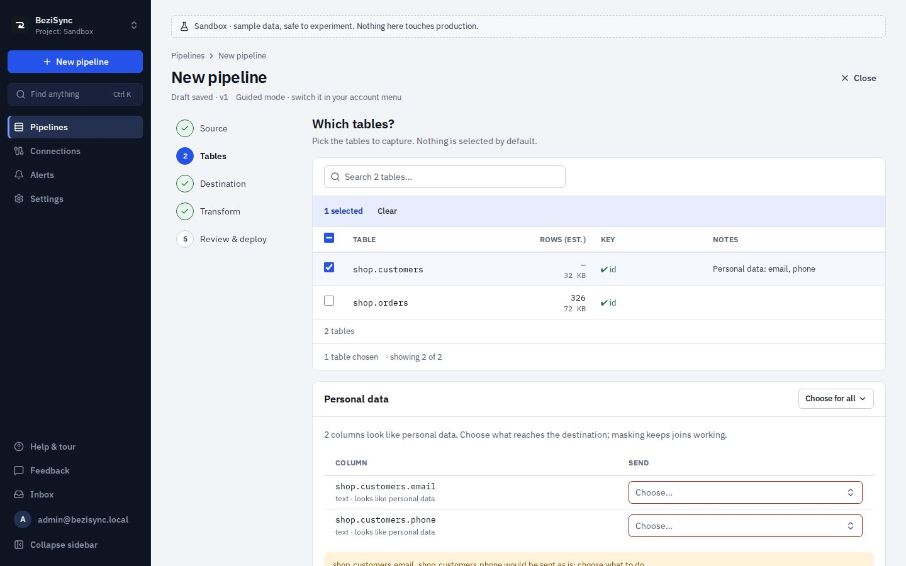

# Personal data

Each pipeline decides what happens to personal data: mask it, remove it or keep it, column by
column. Nothing that looks personal is sent silently.



You choose in the wizard's **Tables** step. Later, change it from **Change → Tables and columns**
or the Data tab's **Tables and personal data**.

## How columns are found

When you pick a table, every column whose name looks like personal data is protected at once.
That covers email, phone, address, birth date, card, IBAN, passport, tax or national ID numbers.
The **Personal data** card lists them, with one choice each.

## Choose what happens to a column

| Choice | What happens |
|---|---|
| **Mask** | Replaced by a salted SHA-256 hash, unique to the pipeline, so equal values still match for joins |
| **Remove** | Left out of every event. Columns that can't be hashed are removed by default |
| **Keep as is** | Sent unchanged, on purpose. The choice is recorded in the spec (`keep`) |

- **Protect another column** masks or removes any other column of the captured tables.
- **Choose for all** sets every row at once.
- Choices you made are never changed when you come back to the step.

## Where masking is offered

| Engine or source | Mask |
|---|---|
| Debezium | Text columns only, so Mask is offered only for those |
| MongoDB | Can't hash at all |
| Flink CDC | No hash function: a Flink CDC pipeline offers Remove and Keep only |

## Final checks

The final checks (Configuration) back these choices up:

| Situation | Result |
|---|---|
| A masked column that can't be hashed | **Blocks** the deploy (it would leak) |
| Personal-data columns nobody decided on (pipelines made through YAML, the API or MCP) | A **warning** naming them |
| A rule on a column that was renamed or dropped | A warning |

A new column that looks like personal data shows as **looks like personal data · sent as is** in
the Data tab's schema changes until you choose.

## In YAML

```yaml
columns:
  public.customers: {mask: [email], exclude: [birth_date], keep: [phone]}
```

## Details

Earlier releases had a project policy, "Require masking personal data". It was replaced by these
per-pipeline choices and is accepted but ignored when sent to the API.

---

[All documentation](../README.md)
