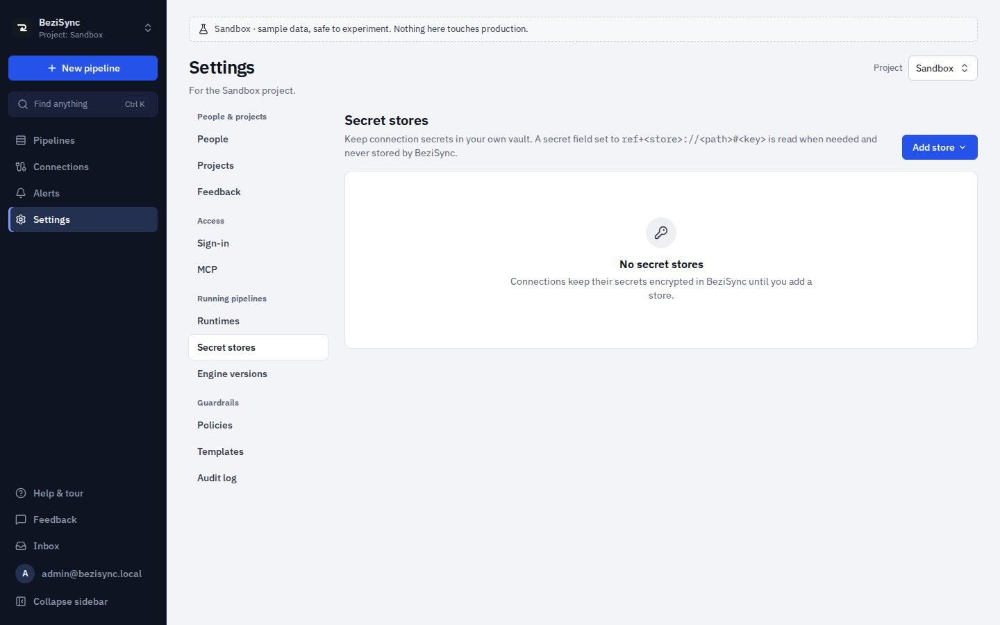

# Secrets and secret stores

Connection secrets are encrypted (AES-256-GCM), write-only and never returned or logged. To keep
them in your own vault instead, an Admin adds a secret store and connections read from it.



**Settings → Secret stores**, Admins only. Supported stores: HashiCorp Vault KV v2, AWS Secrets
Manager, Google Secret Manager and Kubernetes Secrets.

## Add a store

1. In **Settings → Secret stores**, choose **Add store** and the kind of store.
2. Fill in its settings (see [What each store needs](#what-each-store-needs)).
3. Save. BeziSync tests the settings first; if the test fails, nothing is saved.
4. If the test fails because the vault is not reachable from BeziSync yet, choose **Save anyway**.

**Edit** tests the settings the same way before saving. A store's name can't change, because
connections refer to it.

Each store's card shows what it is set to and which credentials are saved, with when they were
last replaced, never their values. **Try a reference** on the card confirms a reference without
showing the value.

## Use a secret from a store

Every secret field of a source or destination offers **Type it** or **From a secret store**. With
**From a secret store**, pick:

1. **Store**: the project's stores, with whether each is connected.
2. **Secret**: listed from the store and searchable. The list shows at most 1,000. Beyond that, or
   when the store's credentials may read but not list, you type the path.
3. **Key**: the secret's key names. One is pre-picked when it is named like the field
   (`password`, `pwd`, `secretAccessKey`, …) or is the only one. A plain-text secret (AWS, Google)
   has no keys and is used whole.

The reference is checked as you pick, and the dialog saves only once it resolves. **Save anyway**
is there for a store that isn't reachable from BeziSync yet; the deploy checks block it if it
stays broken.

## How references work

BeziSync stores only the reference, `ref+<store>://<path>#<key>`, for example
`ref+vault://cdc/orders-db#password`. It reads the value when a connector needs it.

- Values never reach the browser: listing returns secret names and key names only.
- The API and MCP tools take the same reference string.

## What each store needs

| Store | Permissions | Credentials and options |
|---|---|---|
| **Vault** | KV version 2; read on the secrets, and `list` on the mount's `metadata/` paths for the picker to list them | |
| **AWS Secrets Manager** | `secretsmanager:GetSecretValue`, plus `ListSecrets` for the picker | Keys, or the control plane's IRSA / instance role when left empty. *Endpoint* (Expert) takes a VPC endpoint or an emulator |
| **Google Secret Manager** | *Secret Manager Secret Accessor*, plus `secrets.list` for the picker | A service-account key, or Workload Identity when left empty. *Endpoint* (Expert) takes a private endpoint or an emulator; with no key, BeziSync sends no sign-in, as emulators expect |
| **Kubernetes Secrets** | `get` and `list` on Secrets in one namespace | **This cluster** or **Another cluster**; see below |

### Kubernetes Secrets

- **This cluster** uses BeziSync's own service account. The chart grants it in runtime namespaces.
- **Another cluster** asks for a kubeconfig whose user has a static ServiceAccount token. Paste it
  or **Load from a file**.

Sign-in plugins (`exec`, such as `gke-gcloud-auth-plugin`, or auth providers) can't run in
BeziSync. The cluster's API server goes through the same network guard as every other store.

To make such a kubeconfig:

```bash
NS=cdc-secrets
kubectl -n $NS create serviceaccount bezisync-reader
kubectl -n $NS create role bezisync-reader --verb=get,list --resource=secrets
kubectl -n $NS create rolebinding bezisync-reader --role=bezisync-reader --serviceaccount=$NS:bezisync-reader
kubectl -n $NS apply -f - <<EOF
apiVersion: v1
kind: Secret
metadata: { name: bezisync-reader-token, annotations: { kubernetes.io/service-account.name: bezisync-reader } }
type: kubernetes.io/service-account-token
EOF
SERVER=$(kubectl config view --minify -o jsonpath='{.clusters[0].cluster.server}')
CA=$(kubectl -n $NS get secret bezisync-reader-token -o jsonpath='{.data.ca\.crt}')
TOKEN=$(kubectl -n $NS get secret bezisync-reader-token -o jsonpath='{.data.token}' | base64 -d)
cat > bezisync-kubeconfig.yaml <<EOF
apiVersion: v1
kind: Config
current-context: bezisync
clusters: [{ name: c, cluster: { server: $SERVER, certificate-authority-data: $CA } }]
contexts: [{ name: bezisync, context: { cluster: c, user: reader } }]
users: [{ name: reader, user: { token: $TOKEN } }]
EOF
```

The `server` must be an address BeziSync can reach. Delete the local file once it's saved in
BeziSync.

Kubernetes **runtimes** ask the same way: their kubeconfig, GKE and EKS fields appear only for the
sign-in chosen under **Another cluster**.

## Copy to another project

A connection's **⋯ → Copy to project…** (or the same action on several selected rows) copies
sources and destinations into another project where you manage connections. The originals stay.

The dialog shows the plan first:

- A name the other project already uses is copied as `name-2`.
- Or **Update the existing one** replaces its settings, lists the changes and the pipelines there
  that use it, and keeps its own password.

### Passwords and keys

Saved passwords and keys are left out by default. The copy says **Needs its password**, and
nothing that uses it deploys until someone in that project enters it. Admins can choose **Copy
them**: they are copied on the server, still encrypted, and never shown.

A secret that comes from a store the other project lacks needs a choice: copy that store too
(Admins), or use one of the other project's stores.

### Details

- The other project's policies apply, and both audit logs record the copy.
- Admins copy a secret store on its own with **⋯ → Copy to project…** on its card.
- **Promote** offers the same copy when the other project has no matching source or destination.

---

[All documentation](../README.md)
