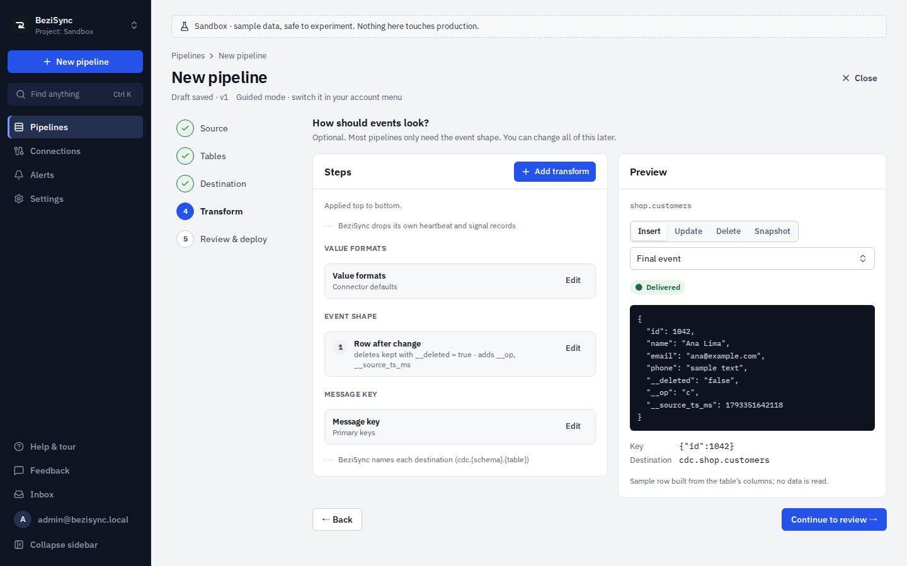

# Shape events (transforms)

The wizard's **Transform** step decides what each event looks like before it reaches the
destination. Use it to filter events, rename or add fields, send tables elsewhere, compute
columns and pick key columns.

Debezium Server chains single message transforms (SMTs). BeziSync offers them by goal and puts
each step at the stage where it works. The **Review** step that follows holds the pipeline's
size, engine settings and advanced properties, described [further down](#review-size).

## The stages

| Stage | What it does |
|---|---|
| [Value formats](#value-formats) | How decimals, timestamps and binary values are written |
| [Keep events](#keep-events) | Keep only some operations and/or rows that match rules |
| [Event shape](#event-shape) | The row after the change or the full change envelope; deletes; **Keep deleted rows** |
| [Field changes](#field-changes) | Rename, add, flatten, **cut long text**, custom transforms |
| [Destinations](#destinations) | **Send tables elsewhere** (routes) |
| [Computed column](#computed-column) | A new column from a function (Flink CDC only) |
| [Message key / Primary key](#message-key--primary-key) | Key columns per table |

Fields are picked from the discovered columns. You only type new names and rule values, and
anything with `${…}` is refused: Debezium Server would read it as a variable, for example a
secret.

### Value formats

| Value | Choices |
|---|---|
| Decimals | Exact bytes (default), a number, or exact text |
| Timestamps | Epoch numbers (default) or ISO-8601 text |
| Binary | Base64 or hex |

These are connector options:

- ISO text exists for PostgreSQL and MySQL only.
- CockroachDB and Vitess send decimals as text only.
- MongoDB and Spanner have none of these options.

### Keep events

Keep only some operations (insert, update, delete, snapshot) and/or rows matching rules on
columns (`is`, `is one of`, `>`, `is empty`, …), for all or some tables.

- The filter runs on the full change event, so deletes are judged on the row before.
- PostgreSQL sends only the key of a deleted row unless the table has `REPLICA IDENTITY FULL`.
- Dropped events are gone for that pipeline; re-snapshot to bring rows back.
- MongoDB can filter on operations only.

On Flink CDC the step is called *Keep only some rows*:

- The table holds exactly the matching rows. A row an update makes match is added; one it stops
  matching is deleted.
- Equality with a number matches whatever the column's number type.
- In Expert mode the condition can be an expression, as for
  [computed columns](#computed-column). Time-of-reading functions such as `NOW()` are not
  allowed, nor is `__data_event_type__`: choose operations instead.

### Event shape

Choose either the row after the change or the full change envelope. With the row shape, deletes
are kept as `__deleted = true`, kept as tombstones, or dropped, and you can add optional metadata
fields such as `__op`.

**Keep deleted rows** (soft delete) keeps every deleted row, marked:

| Engine | How a deleted row is marked | Where the step shows |
|---|---|---|
| Debezium | `__deleted = true`. The row shape is added when missing, and no tombstone follows | Under Event shape. The row shape's Deletes choice is then locked to it |
| Flink CDC | `__op = -D`. Iceberg and StarRocks keep the row | Under Keep rows |

It can be added once. A destination whose own Deletes option it overrides says so.

A table that already has a column of that name is refused (field name duplication). Adding it
changes what consumers get.

### Field changes

- Rename fields.
- Add a field: fixed text or the pipeline's name.
- Flatten nested fields.
- **Cut long text**: cut text columns to at most a length. It runs on Debezium for PostgreSQL and
  MySQL, and on Flink CDC for any source. A masked or left-out column can't be cut. A column of
  another type is left as it is, and blocks on Flink CDC.
- Custom transforms, for Experts, when the policy allows them.

Order matters within this stage, and these steps need the row shape. The message key keeps
column names.

### Destinations

**Send tables elsewhere** (routes) sends the tables a pattern matches to one topic or table you
name, instead of each to its own. A pattern is `schema.table`, where `*` matches any run of
characters, for example `shop.orders_*`. The step lists where every captured table goes.

- Debezium routes after its own naming. Flink CDC writes the matched tables into the named table.
- A table two routes match is refused.
- Tables sent to one destination must have the same key and columns; preflight blocks otherwise.
- A route that matches no captured table is a warning.
- Adding or changing a route moves events, so consumers of the old destination stop receiving
  them.

### Computed column

**Flink CDC only.** Debezium shows the step with why it can't run it.

A computed column is a new column of one table, from a function you pick by group. Its arguments
are picked from the table's columns of the kind the function takes.

| Group | Functions |
|---|---|
| **Text** | Upper/lower case, trim, length, join, join with a separator, part of a text, replace, first/last characters, pad |
| **Numbers** | Absolute value, round, round up/down, add, subtract, multiply, divide |
| **Dates** | Date as text, year, month, day of the month, hour, date from text, days between |
| **Conversions** | As text, whole, decimal or floating-point number |
| **Empty values** | First that isn't empty |

In Expert mode it can be **an expression** in Flink CDC's functions, checked as you type, for
example `CASE WHEN total > 100 THEN 'big' ELSE 'small' END` or `UPPER(city) || ' ' || country`.

How expressions run:

- BeziSync parses every expression and writes its own rendering into the job (ADR 0008), so no
  text you type reaches it as typed.
- Only Flink CDC's documented functions are allowed: no user-defined, AI or regular-expression
  functions, no comments and no `;`.
- Every function is NULL-safe: an empty input gives an empty column, never a stopped job.
- Dividing by zero gives an empty value, and arithmetic is floating point.
- A number compares equal whatever its column type.
- A masked or left-out column can't be an input.

Preflight blocks:

- an input the table no longer has, or of a kind its function doesn't take;
- a name the table already has;
- a column Flink CDC reads as one of its time functions (`now`, `date_format`, …).

### Message key / Primary key

Pick key columns per table, for example for tables without a primary key. Each column is shown
with its type.

**Debezium** (*Message key*) offers the source's columns, on PostgreSQL, MySQL, Oracle,
CockroachDB and Vitess.

- Debezium builds the key at the source, before any step runs. A field a step adds is shown but
  can't be picked, and the key keeps the source's column names.
- A key column the table lacks is ignored by Debezium.

**Flink CDC** (*Primary key*, the destination table's key) offers any column the table writes: a
source column (under its new name when renamed), an added field, or a computed column.

A computed key column must:

- be text or a whole number. An expression whose kind follows its columns needs
  `CAST(… AS STRING)`;
- read only columns that are NOT NULL or in the primary key;
- use a function that always gives a value: not *As a whole number*, *Date from text* or a
  division. A fallback for an empty value isn't enough, since those rows would share a key;
- be the same each time a row is written: no `NOW()` or `UUID()`.

Other Flink CDC key rules:

- On a table with a primary key, a key with an added or computed column keeps the whole primary
  key.
- A key column can't be cut.
- A key column that can be empty in the source is a warning when the key doesn't also hold the
  whole primary key (`transform_key_column_nullable`). Flink CDC writes it as an empty text, so
  those rows would share a key.
- A computed date can't be a key column. To partition an Iceberg table by date, put the timestamp
  column itself in the key (with the primary key) and partition it by its **day** under
  **Partition by**. Iceberg derives the date from it.
- Preflight blocks a key column the table doesn't write (`transform_key_column_unknown`, for
  example a computed column since removed) and one that can't key rows
  (`transform_key_column_unfit`).

On either engine, a key made of a column an update can change moves the row: the old one stays
behind.

## Preview the result

The **preview** builds a sample row from the table's columns; no data is read. It shows the event
after every step for an insert, update, delete or snapshot, with its key and destination. Custom
classes and filter scripts cannot be previewed and show as Unknown.

On Flink CDC, which writes rows into tables, the **Destination table** panel shows instead each
column a table gets:

- its type: the source's type for a source column; for a computed or added column, the kind it
  writes, such as text or a whole number;
- where it comes from: a source column (renamed or cut), an added field or a computed column;
- its key columns, marked.

## Checks at deploy and after

At deploy, preflight checks every step against the tables:

- A field added or renamed onto one the event already has **blocks the deploy**. Debezium would
  stop with "field name duplication".
- These are warnings: steps on missing, excluded or masked columns; rules that can never match a
  column's type; missing key columns; and custom classes Debezium 3.7 does not ship.

Review (and the approval request) lists **what changes for consumers**: Breaking, Key change or
Additive.

After a deploy, the **Events** tab says whether real events match the preview. When a schema
change breaks a step, the pipeline's **Overview** shows it with a **Fix** link and the
*Transform needs attention* alert fires.

Every step is in the spec (`transforms`, `values`, `keys`), so YAML, templates, promote and
rollback carry it. `debezium.transforms*` cannot be set as advanced properties.

## Review: size

A Debezium pipeline runs at one of these sizes:

| Size | CPU | Memory |
|---|---|---|
| Small | 0.5 | 768 MiB |
| Medium | 1 | 1.5 GiB |
| Large | 2 | 3 GiB |
| Custom (Expert mode) | 0.25 to 8, in quarters | 512 MiB to 16 GiB, in 256 MiB steps |

In YAML a custom size reads `policies: {resources: custom, custom_resources: {cpu: "1.5",
memory: 2Gi}}`.

- BeziSync works out the Java heap: 70% of memory, leaving the JVM at least 256 MiB.
- It takes the batch and queue sizes of the largest preset the memory reaches.
- A project's largest size limits a custom one by its CPU and memory, and a destination's
  smallest size does too.

Preflight measures the runtime when it runs (`runtime_capacity`):

- It warns when the CPU or memory free right now is short: the pods may wait for room.
- It blocks, even when forced, when the Kubernetes namespace's ResourceQuota leaves less than the
  pipeline asks for. Kubernetes would refuse its pods.
- It is *unknown*, never passed, when the runtime doesn't report its capacity.
- A redeploy counts only what it adds to what the pipeline runs now.
- Pipelines deployed to the runtime that have no pods yet count too, and are named in the
  message.

Two deploys checked at the very same moment can still each fit alone. Kubernetes then refuses the
pods of the second, and its status gives Kubernetes' reason ("exceeded quota: …").

## Review: saving

**Review & deploy** saves as you change it. When something can't be saved, the badge above the
settings says which field: **Not saved: fix Memory**, or **Memory and 2 more**; **Fix … before
deploying** when a saved value is the problem. Click it to go there; the error sits under that
field.

- In Guided mode, an engine setting or advanced property that blocks the save is listed under
  **Settings that block saving**, with **Remove**.
- When the server refuses a save, Review shows why and waits until you change something, click
  **Try again** (for a network or server error) or leave the step.

## Review: engine settings

**Engine settings** (Review, Expert mode) lists the typed settings BeziSync offers for the
pipeline's engine, source and destination. They are grouped by when they matter: snapshot,
streaming, delivery, engine. Each has its bounds, its default and what changing it does to a
running pipeline. Add one from the searchable list; removing it restores the default.

Debezium pipelines offer:

| Scope | Settings |
|---|---|
| Every pipeline | Snapshot threads, the poll interval, the queue and batch sizes (BeziSync sets them from the size; the batch stays below the queue), a queue memory limit, the wait before reconnecting, skipping unchanged updates, the position save interval and the log level |
| PostgreSQL | Slot feedback interval, slot retries |
| MySQL | Keep-alive, connect timeout, binlog look-ahead |
| Oracle LogMiner | Batch and pause |
| MongoDB | Check for new collections |
| Kafka | Producer linger, batch bytes, compression |
| Pub/Sub | Batch delay and size |
| Redis | Batch size and retry delay |

- A connector's setting is offered only on that connector.
- A destination key a connection field sets is never a setting.
- Sources without JDBC (MongoDB, Spanner) refuse `debezium.source.driver.*` properties.

Preflight checks them against this run's evidence:

| Check | What it verifies |
|---|---|
| `setting_version` | Each tuned setting exists in the image's Debezium release; unknown for an image BeziSync can't place |
| `setting_threads` | Snapshot threads fit the source's free connections; read from PostgreSQL and MySQL, unknown otherwise |
| `setting_queue_memory`, `setting_fetch_memory` | A full queue and a copy fetch fit the heap, estimated from the tables' sizes |

Review, in both modes, suggests settings from the same evidence with one click to use them:
snapshot threads for large copies with free connections, and skipping unchanged updates when
columns are left out. A suggestion is hidden once its evidence is ten minutes old.

## Review: advanced Debezium properties

**Advanced Debezium properties** (Review, Expert mode, one row per key and value) pass raw
`debezium.source.*` and `debezium.sink.*` keys to Debezium Server, for options BeziSync doesn't
offer. They need the project policy *Allow advanced properties*.

They may only add what BeziSync doesn't set. These are refused, with where to set them instead:

- a key BeziSync compiles for the pipeline;
- a key a wizard choice sets: tables, columns and personal data, keys, transforms, the event
  format, where events go, connection and TLS details, heartbeats and signals, the error policy.

Credentials (any key naming a password, secret, token, key store or SASL) belong on the
connection.

Unsafe options are never passed:

| Kind | Keys |
|---|---|
| SQL on the source | `database.initial.statements`, `heartbeat.action.query`, `replica.identity.autoset.values` |
| Dropping or skipping changes | `slot.drop.on.stop`, `offset.mismatch.strategy`, `lsn.flush.*` |
| Weaker TLS | `database.sslfactory` |
| Classes loaded into the connector | `converters`, `*.custom.name`, `post.processors`, `topic.naming.strategy` |
| JDBC driver options (`driver.*`, `database.*`) | Those that read local files, load classes, call out, log to files or change TLS and sign-in, such as MySQL's `allowLoadLocalInfile` and `autoDeserialize`, or a `socketFactory` |
| Other | `snapshot.select.statement.overrides`, logging changes that could reveal secrets, and every `quarkus.*` key |

Values can't hold `${…}` (Debezium Server would fill it in from the pod's environment) or line
breaks.

How saving treats them:

- Saving refuses a key it adds or changes.
- Each row says, as you type, whether BeziSync will pass it on or why not. A key that is also a
  typed setting offers to become one.
- A key an older pipeline already has still saves, but its deploy is blocked by the
  *Advanced properties* check until it is removed. A forced deploy can't skip it.
- The keys that pass show in preflight as **Unknown** (grey, "not verified by BeziSync"), never as
  passed.

---

[All documentation](../README.md)
