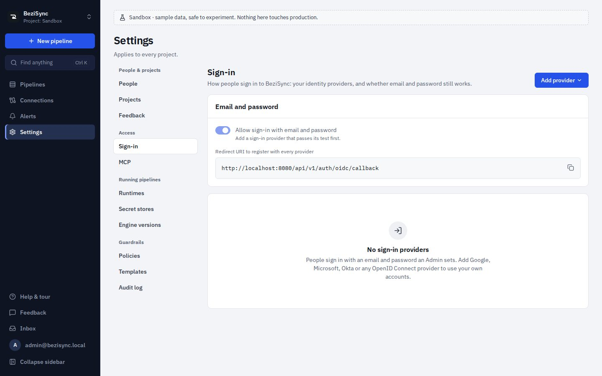

# Single sign-on

Single sign-on (SSO) lets people sign in to BeziSync with your identity provider, and can grant
their roles from the provider's groups. Admins add as many providers as they need.

**Settings → Sign-in**, Admins only.

## Provider kinds

| Kind | For | What you enter | What BeziSync reads |
|---|---|---|---|
| **OpenID Connect** | Google, Microsoft Entra ID, Okta, Keycloak, GitLab, Dex, Auth0, Authentik, … | The issuer URL, client ID and client secret | The ID token, verified against the issuer's keys. Its `email`, `email_verified` and `name` claims unless you name others. A verified email is required |
| **OAuth2: GitHub** | github.com or GitHub Enterprise Server | For Enterprise Server, your host in the three URLs. Needs the `user:email` scope, and `read:org` for groups | The person's primary *verified* address from `/user/emails`, and their organizations (`acme`) and teams (`acme/data-platform`) as groups |
| **OAuth2: other** | Providers without OpenID Connect (Gitea, …) | An authorization, token and user URL, and the names of the user answer's fields: id, email, "email verified", name, groups | The fields you name. An address counts as verified only when that field says so |
| **SAML 2.0** | Okta, Entra ID, ADFS, Google Workspace, JumpCloud, … | The identity provider's metadata URL, its pasted metadata, or its entity ID, HTTP-Redirect sign-in URL and signing certificate | A signed assertion; the email, name and groups attributes you name, or their common names |

## Set up a provider

1. In **Settings → Sign-in**, choose **Add provider** and the kind of provider.
2. Register BeziSync with the identity provider. The form shows every address you need:
   - OpenID Connect and OAuth2: the redirect URI `<public URL>/api/v1/auth/oidc/callback`, the same
     for every provider.
   - SAML: BeziSync's entity ID / metadata URL (`<public URL>/api/v1/auth/saml/metadata`) and ACS
     URL (`<public URL>/api/v1/auth/saml/acs`, HTTP-POST).
3. Enter the identity provider's details from the table above. A SAML metadata URL is re-read at
   every **Test**, so rotated certificates are picked up.
4. Add [group rules](#grant-access-from-groups) if roles should follow the provider's groups.
5. Save. Client secrets are encrypted and never shown again; leave the secret empty when editing
   to keep it.
6. Choose **Test**. It checks what can be checked without a person: discovery and keys, reachable
   endpoints, certificate validity. The first real sign-in proves the rest.

The sign-in page shows one button per provider that is turned on.

## Grant access from groups

Group rules grant access from the provider's groups. Name the claim or attribute if it is not
`groups`, and ask for the scope that adds it.

| Group | Grants |
|---|---|
| `data-platform` | Admin |
| `payments` | `editor` in `payments`, may approve |
| `analysts` | `viewer` in every project |

Project roles are `viewer`, `operator` and `editor`.

- People whom no rule grants any project (including when the provider sends no groups) get the
  provider's **default role** in its **default projects**. With no default role, they get no
  access.
- Roles granted by rules, and the default role, follow the person's groups at every sign-in. They
  show **Managed by SSO** in **Settings → People**.
- Changing such a person's role or approver flag by hand takes that membership off group sync, so
  the change sticks.
- Roles granted by hand are never changed by SSO.

## Attribute mapping

| Kind | Where the email, name and groups come from |
|---|---|
| OpenID Connect | The ID token's `email`, `email_verified` and `name` claims, unless you name others. Entra ID without a mailbox: email claim `upn` |
| OAuth2 | The user answer's fields you name |
| SAML | The attributes you name, or the common ones. `givenname` + `surname` make the name when there is no display name; repeated attributes are merged |

A claim may be a dotted path into the token, such as Keycloak's `realm_access.roles`. An exact
name wins, so Auth0's namespaced claims such as `https://acme.com/groups` work too.

## Verified email

An address counts only when the provider vouches for it:

| Kind | How the address is verified |
|---|---|
| OpenID Connect | The "email verified" claim must be true. Entra ID: add the optional claim `xms_edov` and name it, as the Entra preset does |
| OAuth2 | A field you name for it. GitHub: its primary *verified* address |
| SAML | A signed assertion vouches for its address |

**Accept email addresses the provider has not verified** lets such people in, but only creates new accounts: an unverified
address never signs in to an existing one.

## One sign-in option per person

The first sign-in links a person to that provider's identity, and to an existing account with the
same email. Someone already linked to another provider is refused, so one provider can't take over
another's accounts.

When you move to a new provider, turn on **Take over people who sign in with another option** on
it. People then move to it at their next sign-in (audited).

## Turn off email and password sign-in

You can turn off email and password sign-in once a provider has passed its test and an Admin has
signed in with it, so someone can still manage BeziSync.

- While it is off, the sign-in page shows only the providers. API tokens and MCP keep working.
- BeziSync refuses to turn off or remove the last provider while password sign-in is off.
- If the provider breaks, run `bezisync enable-password-login` in an API or controller pod to turn
  password sign-in back on.

## Provider details

### SAML assertions

Assertions must:

- be signed by the identity provider's certificate;
- name BeziSync as their audience;
- answer the request BeziSync sent (each request and assertion is accepted once);
- carry a persistent or email NameID.

Sign-in started at the identity provider is off unless you allow it.

### GitHub

- Use an OAuth app (Settings → Developer settings → OAuth Apps). A GitHub App's user token needs
  the "Email addresses" and "Members" read permissions.
- Organizations that restrict OAuth apps show no teams until an owner approves BeziSync's app.
- github.com names itself `https://github.com/login/oauth` in its callback (RFC 9207). The preset
  checks it, so a response from anywhere else is refused.

### Callbacks name their issuer

An OpenID Connect callback's `iss` must be the provider's issuer, and is required when the
provider advertises it. An OAuth2 provider's is checked when you set its issuer identifier.

### Groups that don't fit

Sometimes a provider leaves groups out:

- Entra ID sends a link instead of the groups past 200 in a token, or 150 in a SAML assertion.
- GitHub hides organizations whose SAML single sign-on the sign-in isn't authorized for
  (`X-GitHub-SSO: partial-results`).

BeziSync then refuses the sign-in with the reason, instead of syncing an incomplete list, which
would remove roles. Send only the groups assigned to the app, or authorize the organization on
GitHub (`github.com/orgs/<org>/sso`) and sign in again.

### Settings from earlier releases

The `BEZISYNC_OIDC_*` settings of earlier releases are no longer read; the API logs a warning
while any is still set. Add the provider in Settings instead.

---

[All documentation](../README.md)
