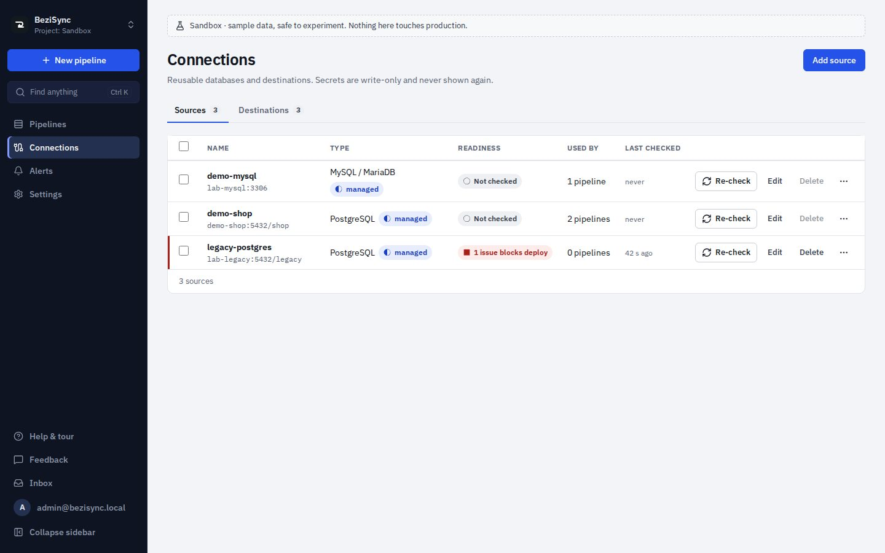

# Sources

A source is the database whose changes a pipeline captures. BeziSync reads PostgreSQL,
MySQL/MariaDB, SQL Server, MongoDB, Oracle, CockroachDB, Vitess and Google Cloud Spanner, and
checks each one before anything deploys.

## What every source gets

- **Readiness checks** of its own database, each failure with the exact fix for the provider.
- **Source protection** shown in its own terms (see [Operate](operate.md)).
- A **Preview** badge when you add it, for sources Debezium marks *incubating*.

What a source can do decides what the wizard offers: the snapshot modes on Review, re-copies on
the Snapshots tab, masking, message keys and the delivery canary.

## What each source can do

The first four columns describe Debezium. The last says whether [Flink CDC](flink-cdc-engine.md)
reads the source too.

| Source | Copies existing rows | Re-copies while streaming | Mask columns | Delivery canary | Flink CDC |
|---|---|---|---|---|---|
| PostgreSQL, MySQL / MariaDB, SQL Server | every mode | yes | yes | PostgreSQL, MySQL | yes (MySQL needs Connector/J in the image) |
| MongoDB | every mode | yes | no | no | no |
| Oracle | every mode | yes | yes | yes | yes, narrower: see *Oracle on Flink CDC* |
| CockroachDB | every mode | yes | yes | yes | no |
| Vitess | "Copy existing rows" or "Only new changes" | no: reset the position from scratch | yes | no | no |
| Google Cloud Spanner | no: it streams from its first start | no | no (columns can be removed) | no | no |

On Flink CDC every source copies its tables in parallel chunks, copies them again only all
together (Start over), can't mask and runs no canary (see [Choose an engine](choose-an-engine.md)).

## Oracle

Oracle 19c and newer through **LogMiner**: self-hosted, on Amazon RDS for Oracle or on OCI Base
Database. Autonomous Database has no LogMiner.

### What the database needs

- **ARCHIVELOG** mode.
- Minimal **supplemental logging**.
- Every captured table logs all its columns
  (`ALTER TABLE … ADD SUPPLEMENTAL LOG DATA (ALL) COLUMNS`).

The checks give each statement, and the GRANT script for whatever the user lacks (`rdsadmin`
procedures on RDS).

### Connection settings

- **Database** is the service Debezium signs in to: the database itself or, for a multitenant
  database, its CDB (for example `ORCLCDB`).
- **Pluggable database** names the PDB with the tables, and then needs a common user (`C##…`). If
  the PDB's service name differs from its name, set it under Expert.
- The connection is plain TCP. Use Oracle Native Network Encryption on the server to encrypt it.

### Details

- BeziSync keeps its signal table `BZ_SIGNAL_<id>` (and `BZ_CANARY_<id>`) in the connector user's
  own schema, so the user needs a quota on its default tablespace. They are removed with the
  pipeline.
- Unquoted Oracle names are upper case, and so are table names in events and destinations
  (`cdc.SHOP.ORDERS`).
- Tables in schemas whose names hold `#` or `$` can't be routed and are not offered.
- LOB columns (`CLOB`, `NCLOB`, `BLOB`, `XMLTYPE`) arrive empty unless the connection's *Capture
  LOB columns* (Expert) is on. `LONG`, `LONG RAW`, `BFILE` and object types are never captured.
- Checks warn when the archived logs reach back less than a day (on RDS: `archivelog retention
  hours`), and when the first copy may outlast `UNDO_RETENTION` (ORA-01555).
- Oracle can also run on Flink CDC (Iceberg, Kafka, StarRocks, Doris, Fluss, Elasticsearch, Paimon,
  OceanBase), with narrower support and more grants: see [Oracle on Flink CDC](flink-cdc-engine.md).

## CockroachDB

CockroachDB v22.2 and newer, self-hosted or Cloud. Debezium reads a **sinkless changefeed** over its
own SQL connection, so no Kafka sits in between.

### What it needs

- Debezium 3.7 or newer. Deploy refuses an older official image, and warns for a custom one.
- `kv.rangefeed.enabled`.
- `CHANGEFEED` and `SELECT` on the tables.
- The right to create the `bezisync` schema (signal and canary tables).
- For CockroachDB Cloud: choose *verify-full* and paste the cluster's CA certificate.

### Details

- Debezium resumes from its last resolved timestamp, which the cluster keeps only for the tables'
  **GC TTL** (`gc.ttlseconds`, 4 hours by default). A pipeline stopped for longer must copy its
  tables again.
- Decimals always arrive as text.
- A table without a primary key is keyed by CockroachDB's hidden `rowid`, which also appears in
  its rows.
- Debezium 3.7 sends the `TIMESTAMP` and `TIMESTAMPTZ` columns of rows copied again on the
  Snapshots tab as empty. Live changes and the first copy carry them.

## Vitess

One keyspace, across all its shards, through **VTGate**. Debezium streams from its gRPC port
(15991) and BeziSync reads tables through its MySQL port (15306). Choose whether to read from
primary, replica or read-only tablets.

- The position is one GTID set per shard.
- How long the tablets keep their binlogs is not visible through VTGate, so source protection
  stays *Unknown*. Keep at least a day of binlogs on every tablet and watch it with your Vitess
  monitoring.
- Vitess can't copy tables again while streaming. To copy everything again: pause, reset the
  position from scratch, and resume.
- Rows of the first copy arrive as inserts.
- Decimals always arrive as text; spatial columns are not captured.
- The gRPC connection is not encrypted, so keep VTGate on a private network (an SSH bastion works
  too).

## Google Cloud Spanner

GoogleSQL databases (not the PostgreSQL dialect) through a **change stream**.

### Coordination Kafka

Debezium's Spanner connector keeps its partition state in two Kafka topics of its own, even in
Debezium Server. So the connection names a **coordination Kafka**: pick one of the project's Kafka
connections. That Kafka connection can't be deleted while a Spanner connection uses it.

BeziSync checks it like a Kafka destination. It removes the connector's
`_sync_topic_spanner_connector_bz_<id>` and `_rebalancing_topic_…` topics when the pipeline is
deleted or its position reset.

### Change stream

By default BeziSync creates one change stream per pipeline, `bz_<id>`:

- it watches the pipeline's tables with full rows (`NEW_ROW_AND_OLD_VALUES`, kept 7 days);
- BeziSync updates it when tables change, and drops it with the pipeline.

That needs schema changes (`roles/spanner.databaseAdmin`). Otherwise create a stream yourself and
choose *Use an existing change stream*.

### Details

- Spanner can't copy the rows a table already has: a pipeline streams the changes made from its
  first start.
- It can't mask columns, but removed columns are left out of BeziSync's change stream, so they
  never leave the database. With your own stream, keep them or let BeziSync create it.
- Without a service-account key, BeziSync and the connector use the default credentials where they
  run (Workload Identity on GKE).
- The emulator (Expert) is for tests.
- Source protection compares how far the pipeline is behind with the stream's `retention_period`.

---

[All documentation](../README.md)
