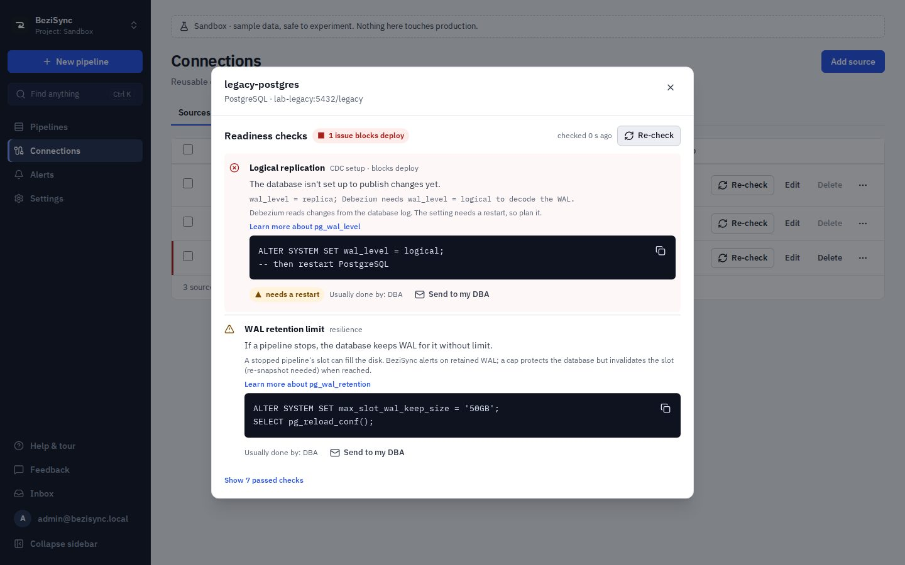
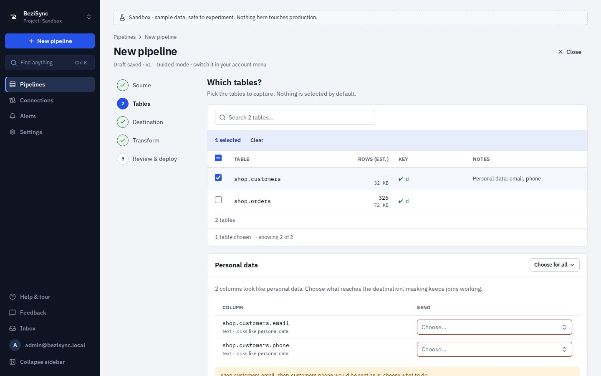
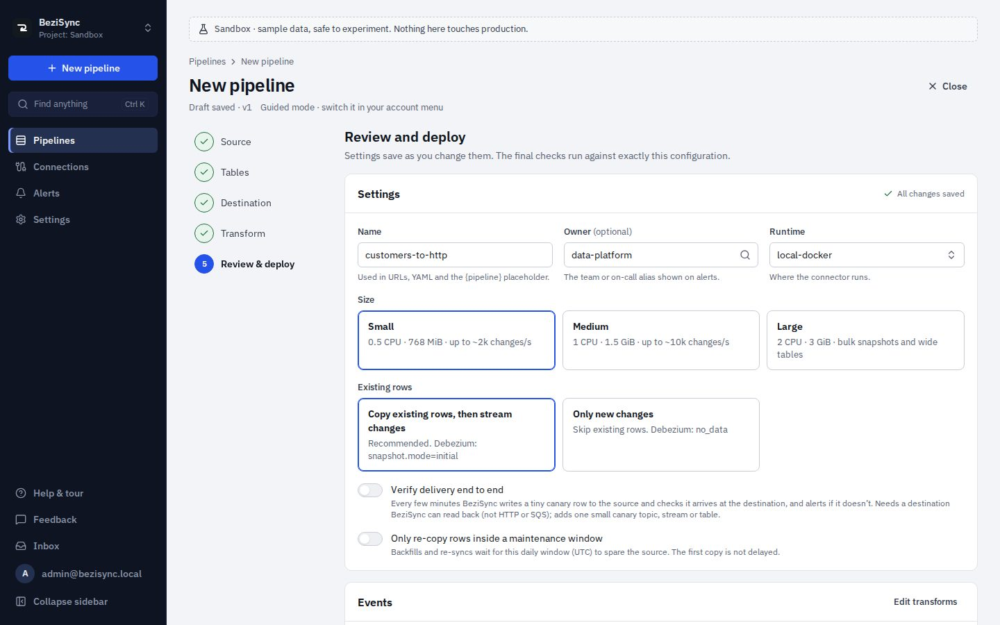
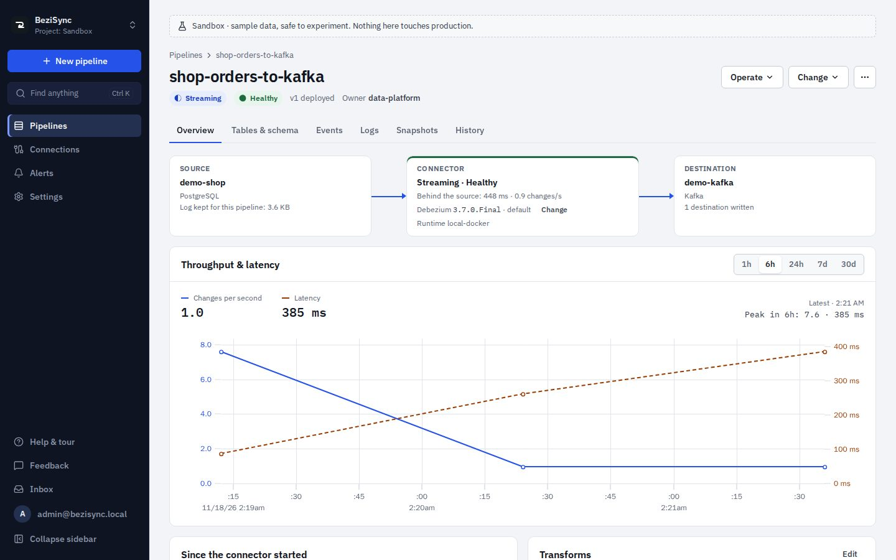

# Your first pipeline

A pipeline streams the changes of a source database to one destination. This page goes from an
empty project to a deployed pipeline. In the [demo stack](install.md#try-it-on-docker) the
runtime and both connections already exist in the **Sandbox** project: start at step 3.

## 1. Add a runtime

**Settings → Runtimes:** add a Kubernetes namespace or a Docker host, or install an
[agent](remote-runtimes-agents.md) for a cluster BeziSync can't reach. See [Manage
runtimes](manage-runtimes.md).

## 2. Add the source and the destination

**Connections → Add source:** pick the source type and fill in its address and credentials.
BeziSync runs readiness checks (logical replication, privileges, retention, keys…) and shows each
failure with the exact fix for your provider (self-hosted, RDS, Cloud SQL, Azure…) and a "send to
my DBA" message. Add the destination the same way, from the **Destinations** tab.

## 3. Create the pipeline

**New pipeline** opens a wizard. A step opens once the ones before it are done, and leaving a step
by any route saves it. Closing a fresh draft asks whether to keep or delete it.

1. **Source:** pick the source connection, or start from a template.
2. **Tables:** select the tables and choose what happens to personal data: mask, remove or keep
   each column (see [Personal data](personal-data.md)).

   

3. **Destination:** pick the destination, its naming and, where it offers both, the engine (see
   [Choose an engine](choose-an-engine.md)).
4. **Transform** (optional): shape the events with filters, renames, routes, keys and computed
   columns (see [Shape events](shape-events-transforms.md)).
5. **Review & deploy:** review the generated `application.properties` and the final checks, then
   deploy.

   

On **Review**, settings save as you change them and the final checks re-run on their own; Deploy
says why while it is unavailable. Final checks must pass. "Deploy anyway" (if the project allows
it) needs a recorded reason and never skips configuration, runtime or policy failures.

## 4. Watch it run

The pipeline page opens on **Overview**: the flow from source to destination, lag, throughput and
what protects the source. Health stays **Unknown** until fresh evidence arrives. See
[Operate](operate.md).

---

[All documentation](../README.md)
